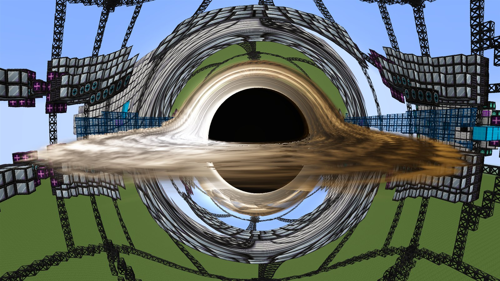
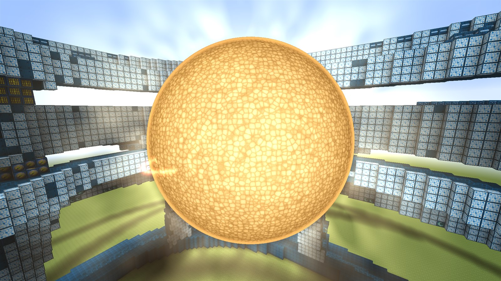
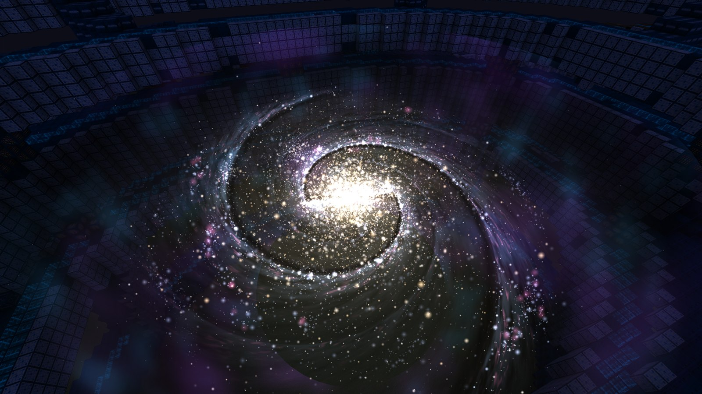
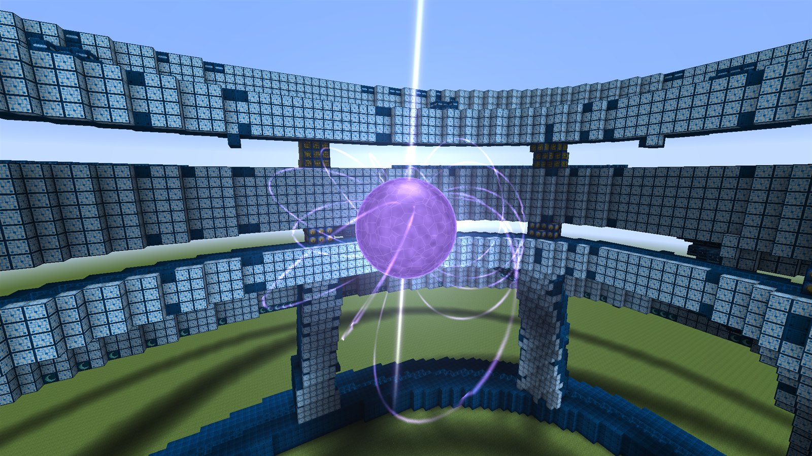
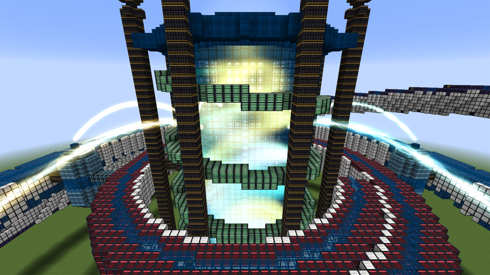
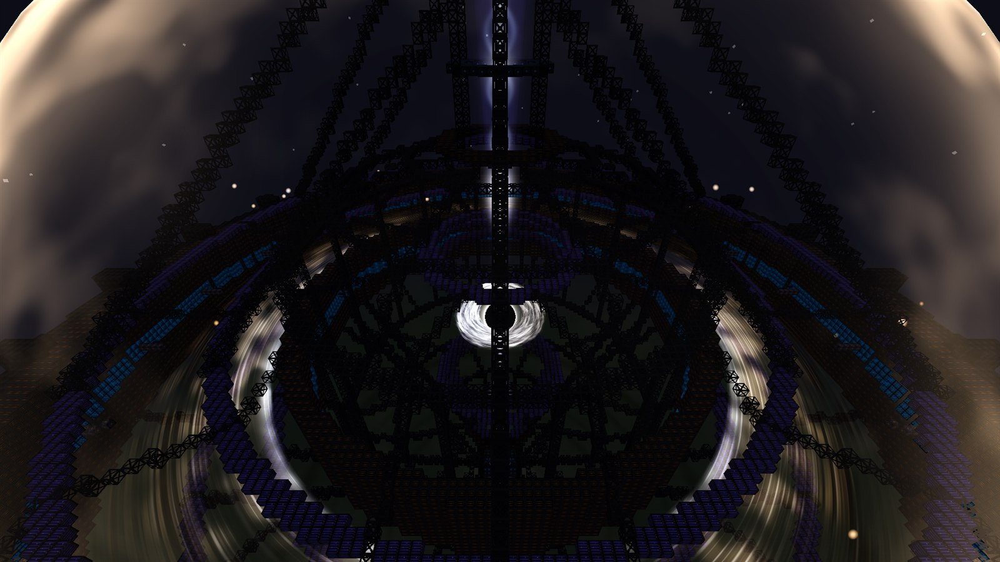
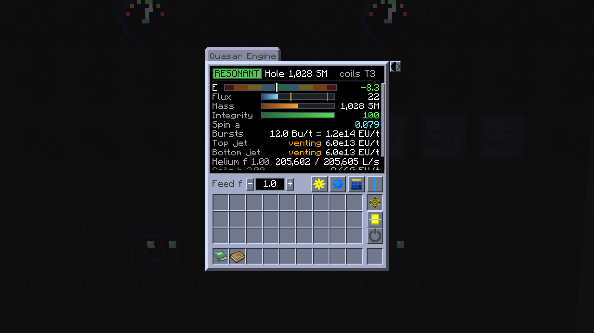
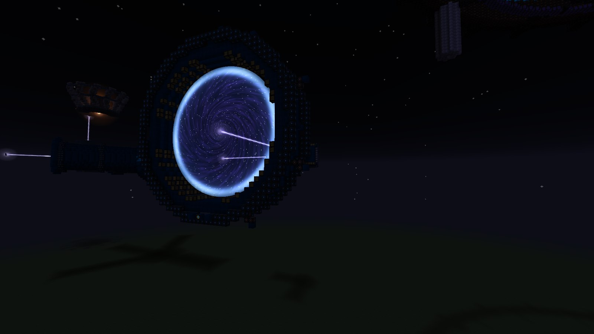
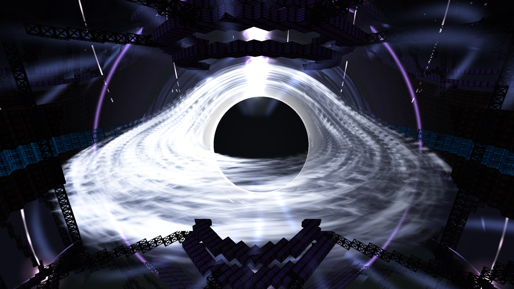
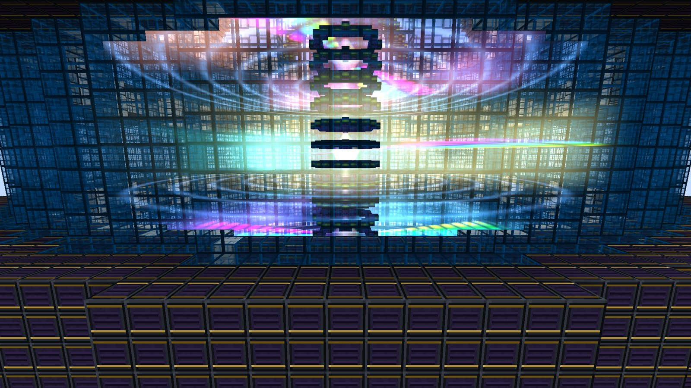

# GTNH: Beyond the Stars

An addon for **GregTech: New Horizons 2.9.0-RC-2** that rebuilds the post-UEV endgame as one connected climb, which we
call the **Singularity Ladder**. A lab-grown black hole replaces the Black Hole Compressor. A new Eye of Harmony runs
live stars, then dead stars, then whole galaxies. A Quasar Engine grows its own black hole and fires gamma-ray bursts
that power your base and hold the bigger machines stable. Every one of them is a large, fully automatable
multiblock with its own questbook chapter.

- **Mod id:** `beyondthestars` · **Minecraft** 1.7.10 · **Pack:** GTNH 2.9.0-RC-2 only
- **Version:** 0.25.0, our first public release: `beyondthestars-0.25.0.jar` from the tagged release on GitHub. Builds
  between releases show a version such as `0.25.0-master.12+1a2b3c4d5e`.
- **Status:** first public release, still a playtest. Back up your world before you install it, and expect balance
  changes between releases.
- **Installing:** read [INSTALL.md](INSTALL.md) first. With the default config an already built TecTech Eye of
  Harmony stops working, and a few pack recipes change.



---

## Contents

- [What it changes in GTNH](#what-it-changes-in-gtnh)
- [Progression at a glance](#progression-at-a-glance)
- [Units used in this README](#units-used-in-this-readme)
- [The machines](#the-machines)
  - [Kerr Ergosphere Engine and its modules](#kerr-ergosphere-engine-and-its-modules)
  - [The Eye of Harmony, T1 to T8](#the-eye-of-harmony-t1-to-t8)
  - [The Homogeny](#the-homogeny)
  - [The Quasar Engine](#the-quasar-engine)
  - [Bursts and the Burst Thermaliser Crown](#bursts-and-the-burst-thermaliser-crown)
  - [The Einstein-Rosen Conduit](#the-einstein-rosen-conduit)
  - [Quasar links: bursts as stability](#quasar-links-bursts-as-stability)
  - [The Supermassive Lattice](#the-supermassive-lattice)
  - [Reality Diffraction and Reality Refab](#reality-diffraction-and-reality-refab)
- [Circuits: Sidereal, Empyrean and Omega](#circuits-sidereal-empyrean-and-omega)
- [BEC (Condensate Assembler) integration](#bec-condensate-assembler-integration)
- [Field-generator upgrade path](#field-generator-upgrade-path)
- [New materials](#new-materials)
- [The Nuclear Plant (the older layer)](#the-nuclear-plant-the-older-layer)
- [Automation](#automation)
- [Questbook](#questbook)
- [Renders and performance](#renders-and-performance)
- [Installation](#installation)
- [Configuration](#configuration)
- [Commands](#commands)
- [Known issues and playtest notes](#known-issues-and-playtest-notes)
- [Reporting bugs](#reporting-bugs)
- [Building from source](#building-from-source)
- [Credits and license](#credits-and-license)

---

## What it changes in GTNH

Most of the mod adds things. Two pack machines are replaced, and the replacement is a config switch in each case.

| Pack content | What happens | Switch (default) |
|---|---|---|
| **Black Hole Compressor** (BHC) | Its controller recipe is removed. The **Kerr Ergosphere Engine** takes its place at UIV. Every recipe that *consumes* a BHC controller (the nine Spacetime Compression Field Generator tiers, and the coremod's Empty Spatially Compressed Circuit Array, which takes 64) is rewritten in place to take a Kerr controller instead, same count. BHCs you have already placed keep working. Spare BHC controllers can no longer be used as ingredients. | `removeBlackHoleCompressorRecipe` (`true`) |
| **TecTech Eye of Harmony** (EOH) | At load we copy every TecTech planet recipe (43 in RC-2) into our own **Eye of Harmony**, then clear TecTech's recipe storage, its NEI page and its controller recipe. A placed TecTech EOH still forms but finds nothing to run. Planet runs no longer drop Raw Star Matter, White Dwarf Matter, Black Dwarf Matter or Universium: those now come from our Eye's stars. The Deep Dark moves to Eye T4. If the copy fails for any reason, TecTech's Eye is left untouched and the log says so. | `replaceTecTechEyeOfHarmony` (`true`) |
| Resonance Chambers II, III, IV | GT's own Condensate Assembler recipes are rewritten in place so the compression generators can be built before the matter that used to gate them: II takes 2 SpaceTime foils, III takes 2 White Dwarf Matter foils, IV takes 2 SpaceTime foils plus 1,500 L Entangled Ergomatter. | `replaceTecTechEyeOfHarmony` |
| Eternity (Temporal Harmony Catalyst, Timepiece) | Takes Ergomatter (9,216 L and 4,608 L) instead of a Universium Nanite, so Eternity arrives around Eye T7 instead of after the last Eye tier. | `replaceTecTechEyeOfHarmony` |
| Godforge magmatter upgrade | Costs 8 Black Dwarf Matter frame boxes instead of 2 Universium ones, so MagMatter is reachable before the top of the ladder. | `replaceTecTechEyeOfHarmony` |
| TecTech Reinforced Spatial / Temporal Structure Casing | Their Condensate Assembler recipes make 32 instead of 4 (an Eye uses thousands). | none |
| Nanochip Assembly Complex: Piko, Quantum, Raw Manifold Bud, Planck | 2.5x the time at the same EU/t, 2x the items and fluids (the Quantum CPU, Planck CPU and Calabi-Yau Manifold inside stay at 1). | `raiseStockSpecialCircuits` (`true`) |
| UMV / UXV / MAX circuit slots | Three new circuit families fill every "any circuit of the tier" slot (Assembly Line slots included), at far lower cost. Nothing requires them by name. | `stellarCircuits` (`true`) |
| The pack's questbook | 66 pack quests are edited (the BHC quest becomes the Kerr, the EOH quest becomes our Eye, UXV / MAX / endgame quests move into our chapters) and the emptied Endgame Goals chapter is hidden. Progress is kept. | `questbookPackEdits` (`true`) |

With every switch off, the BHC, TecTech's EOH and the stock circuit costs are exactly as the pack ships them, and our
machines sit beside them as extras.

## Progression at a glance

Each rung produces the matter, or the stability, that the next one needs. Quests live in the tier chapter shown.

| Tier | Machine | Makes | Unlocks / feeds |
|---|---|---|---|
| UIV | **Kerr Ergosphere Engine T1** + Compressor and Extractor Modules | Runs GT's Compressor, Neutronium Compressor and Extractor recipes with big parallels | Replaces the BHC; its controller is an ingredient of every compression field generator |
| UMV | **Eye T1: Sol** | Raw Star Matter | Sidereal circuits; Homogeny T1; Eye T2 |
| UMV | **Eye T2: Sirius A** | Excited Stellar Plasma Mixture (ESPM) | Stellar SMDs; Eye T3 |
| UMV | **The Homogeny T1** | ESPM from Raw Star Matter (slower than Eye T2) | Homogeny T2 |
| UMV | **Eye T3: Arcturus** | Raw Hyperdense Stellar Plasma | Kerr T2 refines it |
| UMV | **Kerr T2** (Density Upgrade) | Hyperdense Stellar Mixture (HSM); later the Quasar Seed | Eye T4; the Quasar Engine |
| UMV | **Eye T4: Neutron Star** | White Dwarf Matter; the Deep Dark planet | Empyrean circuits; Eye T5 |
| UXV | **Eye T5: Sirius B** | Black Dwarf Matter | Omega circuits; Homogeny T2; Eye T6 |
| UXV | **Eye T6: SGR 1806-20** (a magnetar) | Magnetar Matter | The Quasar Seed and Quasar Engine; Eye T7 |
| UXV | **The Homogeny T2** | Degenerate Stellar Mixture | Reality machines (MAX) |
| UXV | **Quasar Engine**, **Einstein-Rosen Conduit**, **Burst Thermaliser Crowns** | Gamma-ray bursts, and EU/t onto your wireless network | Holds Eye T7 / T8 stable; links speed up the Kerr and Homogeny |
| UXV | **Eye T7: Triangulum** | Ergomatter | Conduit upkeep; Eternity; Eye T8 |
| UXV | **Eye T8: the Milky Way** | Superdense Ergomatter | Supermassive Lattice L1; Homogeny T3 |
| UXV / MAX | **Supermassive Lattice** L1 to L4 on the Quasar Engine, Overdrive and Unbound | Holes past 4,096 solar masses, far larger bursts | Endgame power; the Eye T9 to T10 link |
| MAX | **Eye T9: the Great Attractor**, fed a beam of Gated Pellets | Attractor Dark Matter | Every MAX part; Homogeny T3; Reality machines; the L2 lattice |
| MAX | The Homogeny T3, Reality Diffraction, Reality Refab | Entanglement Medium, the six Entangled Regions, the Universal Upgrade Core, the tenth compression tier | Eye T10 |
| MAX | **Eye T10: the Universe** | Universium (the only source) | The Endgame chapter (MHDCSM line, the crafted Stargate); the L3 lattice |

Universium is an Eye T10 product and only that, so nothing before T10 needs it: the MAX parts are made from Attractor
Dark Matter, and where a recipe before T10 names one of RC-2's UXV components (which take Universium) it takes two UMV
ones instead. With `replaceTecTechEyeOfHarmony=false`, TecTech's own Eye still makes Universium.

## Units used in this README

- **SM** is a solar mass, the unit of black-hole mass in every GUI.
- **Bu/t** is the gamma-ray burst rate. **1 Bu/t = 10^13 EU/t** when a crown turns it into power. Every GUI, tooltip,
  NEI page and quest shows EU/t next to Bu/t. We do the same here.
- **Eye-seconds** run faster than real seconds when an Eye's time dial is above 1.
- Recipe voltages are GT's `RECIPE_` values, for example 1 A UMV = 125,829,120 EU/t and 1 A UXV = 503,316,480 EU/t.

---

## The machines

Every machine below is a GregTech multiblock with a StructureLib hologram, a survival auto-place, an NEI
"Multiblock" preview for each tier, its own GUI with an Info page, and a tooltip that lists every socket. All machine
ids sit in 28100-28139 (see [Configuration](#configuration)).

### Kerr Ergosphere Engine and its modules

A lab black hole held in a 65-block-tall cage. The engine (KEE) only holds the hole. Two separate module multiblocks
docked in its arcs do the processing, and they run only while the hole is open.

| Machine | MTE id | Tier | Size (assembled) |
|---|---|---|---|
| Kerr Ergosphere Engine | 28114 | UIV | T1: 76 x 65 x 79, 12,357 blocks with both modules. T2: 92 x 65 x 89, 26,516 blocks |
| Kerr Compressor Module | 28117 | its own energy | 33 x 11 x 20 arc |
| Kerr Extractor Module | 28118 | its own energy | 16 x 11 x 9 arc |

**Holding the hole**

- **Open:** put a Black Hole Seed in a bolt bus (with Auto on, the default, it is used by itself), or press Open in the
  GUI. The hole opens at 8 SM.
- **Close:** put a Black Hole Collapser in a bolt bus, or press Collapse twice within 4 seconds.
- **Mass setpoint:** any whole number from 2 to 64 SM (T1), 2 to 512 SM (T2), or up to 768 SM on a T2 linked to a
  quasar (see [Quasar links](#quasar-links-bursts-as-stability)).
- **Hawking bleed:** the hole loses 3.2 / M² SM every tick. Small holes evaporate fast: about 21 seconds at 16 SM,
  about 23 minutes at 64 SM, with no feed. Below 2 SM the hole closes.
- **The bolt governor** fires bolts from the 8 bolt buses to hold the setpoint. Bolt masses: Neutronium 1/64,
  Cosmic Neutronium 1/32, Infinity 1/16, Transcendent Metal 1/8, SpaceTime 1/4 SM. The slowest Bolt Injector Rail in
  the cage sets the cap: Mk I 4, Mk II 8, Mk III 16 bolts per tick.
- **Containment power:** 8,388,608 EU/t (1 A UEV) every tick while the hole is open, from the KEE's own energy hatches.
  Without it the governor stops and the hole bleeds down until it closes.
- **What can go wrong:** losing power or bolts lets the hole shrink and close. An unformed KEE freezes the hole (no
  bleed, no feed) and pauses its modules. Nothing explodes. Wrenching the controller keeps the hole, the mass and the
  setpoint.

**The modules**

- **Parallel** = 8 x (the module's energy-hatch voltage tier) x floor(sqrt(M)). With a UIV hatch: 352 at 16 SM,
  704 at 64 SM, 1,936 at 512 SM.
- **Speed** = 64 / M, clamped to 1x-4x: a small, hot hole runs recipes up to 4x faster; a big one runs them at 1x
  with more parallels. Both are fixed when a recipe starts.
- **Compressor Module:** GT's Compressor and Neutronium Compressor maps, plus the Kerr's own **Densification** map,
  which needs Kerr T2 and at least 128 SM:
  - Hyperdense Stellar Mixture: 10,000 L Raw Hyperdense Stellar Plasma + 288 L SpaceTime + 64 Neutronium bolts gives
    1,000 L (20 s, UMV).
  - **Quasar Seed** (needs 256 SM): 4 Black Hole Seeds + 64,000 L HSM + 1,440 L Magnetar Matter (1,200 s, UXV). It
    costs the hole nothing.
  - Superdense Ergomatter, the slow way (needs 256 SM and a quasar link at σ ≥ 1): 4,000 L Ergomatter + 1,440 L
    SpaceTime gives 500 L (8 : 1, 600 s, UXV).
- **Extractor Module:** GT's item Extractor recipes, item buses only.
- A module with no open hole, or no formed KEE, pauses with its recipe and progress kept.

**Kerr T2** is the Kerr Density Upgrade (Condensate Assembler, 3,600 s at 4 A UMV, including 4,000,000 L Entangled
Raw Star Matter and 32 Black Hole Seeds). Right-click the KEE controller with it. It is permanent: the cage must be
rebuilt to the T2 shape (Bastion and Casimir Plate reinforcement) and the setpoint cap rises to 512 SM.

**Controller recipe:** Assembly Line at UIV, researched from a Black Hole Seed, priced at about one BHC controller.
The module controllers are UIV Assembly Line recipes researched from the KEE.

### The Eye of Harmony, T1 to T8



One controller (MTE 28115), eight tiers. Each tier adds a band around the last, and each band counts only while every
band below it stands. Stars are no longer batch runs: a star **burns live**, takes its upkeep and EU every 60-second
cycle, and delivers its product to an ME output bus or hatch at the end of every cycle (ME output is the only output
path).

| Tier | Size w x h x d | Blocks (total) | New band |
|---|---|---|---|
| T1 | 102 x 52 x 80 | 19,245 | core on its pylons |
| T2 | 102 x 57 x 80 | 23,588 | beam band |
| T3 | 102 x 57 x 80 | 27,572 | jet crescent |
| T4 | 102 x 57 x 137 | 33,709 | spiral arms |
| T5 | 135 x 57 x 137 | 39,569 | second arms |
| T6 | 158 x 57 x 149 | 50,558 | galactic rim |
| T7 | 183 x 59 x 175 | 65,948 | stability rail (8 GRB Receptor Ports) |
| T8 | 196 x 73 x 218 | 69,657 | shard halo (8 more ports) |

The structure is built mostly from TecTech's own EOH blocks (Reinforced Spatial and Temporal Structure Casing,
Infinite SpaceTime Energy Boundary Casing, Quantum Glass) plus our band casings.

**What runs a tier.** The installed tier is the lowest of: the tier you have unlocked, the bands standing, and the
**Spacetime Compression Field Generators**. Every compression generator must be at the Eye's tier (T8 needs tier-8
generators, whose gate part is Resonance Chamber IV). Time Dilation generators cap the time dial; Stabilisation
generators damp the field's noise and events.

**Power.** Wireless EU only. A star costs 125,829,120 x 4^(T-1) EU/t per parallel, charged once per cycle: about
1.3 x 10^8 EU/t at T1, 5.15 x 10^11 EU/t at T7 and 2.06 x 10^12 EU/t at T8.

**Parallels and the time dial.** A star below the installed tier runs 2^(installed - T) parallels. The time dial
(1.0-3.0 in 0.25 steps, capped by the Time Dilation generators) speeds the Eye up and costs molten Time (Tachyon
Rich Temporal Fluid) every second; transitions always run at 1x.

#### The stars

| Tier | Object | Upkeep per 60 s cycle (one parallel) | Product per cycle |
|---|---|---|---|
| T1 | **Sol** | 50,000,000 L Hydrogen + 50,000,000 L Helium | 50,000 L Raw Star Matter |
| T2 | **Sirius A** | 12.5 M L H + 12.5 M L He + 25,000 L Raw Star Matter | 2,500 L Excited Stellar Plasma Mixture |
| T3 | **Arcturus** (red giant) | 12.5 M L H + 12.5 M L He + 1,250 L ESPM | 625 L Raw Hyperdense Stellar Plasma |
| T4 | **Neutron Star** (Arcturus remnant) | 144 L Molten SpaceTime + an HSM feed you set, 0-1.5 L/s (default 0.694) | 3.6864 L White Dwarf Matter per L of HSM (about 153 L at the default) |
| T5 | **Sirius B** (cooling white dwarf) | EU only; each 2-hour cooling batch is charged 18,432 L White Dwarf Matter | 4,608 L Black Dwarf Matter per batch |
| T6 | **SGR 1806-20** (magnetar) | 3,000 L Antipolarization Agent + a White / Black Dwarf Matter reserve topped up every 60 cycles | 15 L Magnetar Matter, plus 12 Purified Tengam dust back per 1,000 L of Agent |
| T7 | **Triangulum (M33)** | 7.5 L Magnetar Matter + bursts (1.5 Bu/t = 1.5 x 10^13 EU/t) | 600 L Ergomatter x Y x r x min(β, 1.5) |
| T8 | **The Milky Way** | An Ergomatter feed, 0-10 L/s (default 5) + bursts (6 Bu/t = 6 x 10^13 EU/t) | Superdense Ergomatter, 1 L per L of Ergomatter fed, x Y x r |

Every product is multiplied by **Y**, the cycle's mean field yield (below), and **r**, the share of upkeep that
arrived. **β** is the share of the burst demand that arrived.

**Lighting a star (T1-T3).** Put a Stellar Ignition Charge in a plinth input bus. The Eye must hold 10 cycles of
upkeep plus a seed cloud of H and He, and the 10 cycles of EU are taken from the network at ignition. The protostar
collapses for about 40 seconds and then lights.

**Intake cap.** Each buffer fills only to its cap: 20 cycles of upkeep or the ignition need (whichever is larger),
plus what the next transition needs. One ME stocking hatch no longer empties a whole network into the Eye. The
Field panel's Buffers section shows held / cap.

#### The stability field

Every tier has a live field you hold with **trims**: small doses of fluid through the core's 8 Field sockets. Each
gauge has a target of 0, and the zone is set by the worst gauge.

| Zone | Worst gauge | Yield Y | Integrity per second |
|---|---|---|---|
| Resonant | within ±10 | 1.25 (1.5 after 600 s unbroken: Harmonic Lock) | +1 |
| Stable | within ±40 | 1.0 | +0.2 |
| Strained | within ±70 | 0.5 | -0.5 |
| Critical | within ±100 | 0 | -2 |
| Breach | past ±100 | the star fails | |

Integrity at 0 also fails the star. The gauges, and what moves them:

| Tier | Gauges | Character | Trims (per unit) |
|---|---|---|---|
| T1 Sol | P (pressure) | Settles by itself | Helium P-2, Hydrogen P+2 |
| T2 Sirius A | P | Drifts faster; too much Helium leaves "ash" that cuts yield | Helium, Hydrogen |
| T3 Arcturus | P, Θ (core heat) | Runaway heat. **Helium flash** every 1,200-2,400 s, warned 15 s ahead: 3 s of Θ +30/s | Helium, Hydrogen, Super Coolant |
| T4 Neutron Star | P, Θ, Ω (spin) | Your HSM feed pushes all three up. **Glitch** every 900-1,800 s, unwarned: Ω +20 | Space, SpaceTime, Super Coolant, Molten Purified Tengam |
| T5 Sirius B | P, Θ against a setpoint that falls from +90 to -90 over the 2-hour batch | A plateau near 0 is warned 15 s ahead | Dimensionally Shifted Superfluid, Raw Star Matter, Helium |
| T6 Magnetar | P, Θ, Ω, Π (polarity) + a shield | **Giant flare** every 60-120 s, warned 15 s ahead with its sign: 4 s of Π ±25/s. The Agent charges a shield that absorbs up to 25 Π a second | T4's four + Antipolarization Agent |
| T7 Triangulum | P, W (rail warp) | Bursts push P; where you aim them on the rail (high or low bank) steers W. **Minor merger** every 900-1,800 s, warned 15 s | Space |
| T8 Milky Way | P, W, Λ (tidal shear) | As T7; the Ergomatter feed raises Λ, bursts into the halo lower it. **Satellite crossing** every 1,800-3,600 s with a 120 s countdown: hold Stable for all 300 s and you get a bonus cycle | Space |

#### Transitions

The first time you climb a tier you need that tier's **milestones**, its **upgrade core** placed in escrow
(right-click the controller, or push it into a plinth bus), the next band built, compression at the new tier, and
the event's fluids buffered. Load the next star chart and the transition runs. Success unlocks the tier for good and
consumes the core. Failure loses the star and the event materials, but **the core stays in escrow**. Re-running a
transition later needs no core.

**A lost star relights at the base tier of its band** from a new charge, without the chain below (D-54). T1-T3
relight at their own tier from a Stellar Ignition Charge. The neutron star relights at T4 from a Stellar Ignition
Charge and a 5,000 L Hyperdense Stellar Mixture seed (no Arcturus, no Core Collapse re-run). Sirius B and the magnetar
relight at their own tier from their own charges. A lost Triangulum, Milky Way or Great Attractor relights at
Triangulum (T7) from a new Magnetar Collapse charge (White and Black Dwarf Matter, once a quasar's bursts reach the
ports); the Galactic Merger and The Infall then re-run on Begin. A lost universe comes back as a new universe at T10
from a 9,216 L Attractor Dark Matter charge. Each relit star also needs its first cycle buffered and its EU.
Milestones, unlocked tiers, the escrowed core and the counters are never lost, so a re-climb needs only each
transition's event, with no core and no milestone grind.

| Step | Milestones | Core | What you have to survive |
|---|---|---|---|
| T1 to T2: **Mass Infusion** | 20,000,000 L Raw Star Matter made; 2 h Resonant | Stellar Mass Core | 5,000,000 L Raw Star Matter poured in; 600 s with the pressure climbing |
| T2 to T3: **Shell Ignition** | 1,000,000 L ESPM made; 3 h Resonant | Shell-Burning Core | Core heat ramps in over 600 s, ending in a forced helium flash |
| T3 to T4: **Core Collapse** | 400,000 L Raw Hyperdense Plasma; 4 h Resonant; 3 helium flashes ridden | Galactic Upgrade Core | Dose molten Time (up to 100 L/s) until the core bounces (about 94,000 L). The bounce shock is +150, less 1 per 1,000 L of SpaceTime buffered (up to 90,000 L). Past +100: **supernova**, Arcturus is lost. Then hold the new neutron star Stable for 60 s within 180 s |
| T4 to T5: **First Cooling** | 147,456 L White Dwarf Matter from all-Stable cycles; 4 h Resonant; one Deep Dark run on this Eye | Subspace Cooling Core | The first Sirius B batch, with a mean yield of 0.9 or better and no fracture |
| T5 to T6: **Magnetar Merger** | 6 good cooling batches | Magnetar Seed Core | Charge 18,432 L WDM + 4,608 L BDM + 100,000 L Agent. Imprint: hold Π between +60 and +90 for 120 s, then release to within ±40 |
| T6 to T7: **Magnetar Collapse** | The **Stability Link** (a quasar's bursts at 1.5 Bu/t = 1.5 x 10^13 EU/t or more into the rail for 30 min unbroken); 2,700 L Magnetar Matter all-Stable; 2 h Resonant; 50 giant flares ridden | Intergalactic Upgrade Core | Begin, then 300 s of overfeeding. On the collapse second the shock is +120, cancelled by 10 per Bu/t above 1.5 that arrives that second: 13.5 Bu/t (1.35 x 10^14 EU/t) cancels it all. The Directive cue comes on 2 s early so a wired purge lands on time. Then capture the halo |
| T7 to T8: **Galactic Merger** | The **Heavy Link** (6 Bu/t = 6 x 10^13 EU/t for 30 min, half into the halo); 216,000 L Ergomatter all-Stable; 2 h Resonant; 4 minor mergers ridden | Supermassive Seed Core | 1,800 s with three pericentre passes (each warned 60 s ahead) while the burst demand ramps from 1.5 to 6 Bu/t |

The GUI warns you in red, before Begin, when the linked quasar is too weak to cancel the Magnetar Collapse shock (a
fresh 64 SM hole never is; a settled quasar of about 136 SM or more is).



#### Planets, planets mode and companions

- **Planets (all tiers):** put a planet item in the controller slot and the Eye runs TecTech's converted recipe as a
  batch run. Rocket tiers 0-3 run at T1, 4-6 at T2, 7-8 at T3, and the Deep Dark at T4. A run takes 20 min x 1.25^R
  (the Deep Dark 240 min) and runs 2^(installed - tier) parallels. Each compression tier above the planet's
  requirement cuts the time by 3 %.
- **Planets mode (T7 / T8):** instead of the galaxy, run 3 (T7) or 6 (T8) planet slots at once in a calm one-gauge
  field that needs only a quarter of the burst demand.
- **Companions (T7 / T8):** in galaxy mode, put 1 (T7) or 2 (T8) earlier star charts in the slot bus. Each runs beside
  the galaxy, pays its own upkeep and adds a quarter of the burst demand.

#### Eye T9 and T10

- **T9, the Great Attractor:** the hidden mass at the heart of Laniakea. A beam of **Gated Pellets** fired down the T9
  collimator stack by the **Pellet Injector Hatch** holds the infall (gauge V). Galactic Flows of 3 to 12 galaxies come
  down the filaments; hold one and every galaxy in it is captured. Output: **Attractor Dark Matter**, 144 L a cycle plus
  144 L a captured galaxy (about 12,300 L/h on the standard rig). The T8 to T9 core is the **Attractor Seed Core**.
- **T10, the Universe:** one universe per 7,200 s batch, kept on its Friedmann curve (gauge H) with Dark Matter and
  SpaceTime trims. Output: **Universium**, 9,216 L a universe (about 6,200 L/h), the only source. The T9 to T10 core
  is the **Universal Upgrade Core** from Reality Refab, and every compression slot needs the tenth tier, the
  **Universal Compression Field Generator**. The milestone is the **Supermassive Link** (96 Bu/t = 9.6 x 10^14 EU/t for
  30 min from a lattice quasar of at least 65,536 SM).
- **Gated Pellets** (Kerr Compressor Module, 16 a craft): Magnetar (1.25 EeV) from Magnetar Matter, Degenerate Stellar
  Mixture and Casimir Plates; Ergomatter (5 EeV) from 4 Magnetar pellets and Ergomatter; Superdense (20 EeV) from 4
  Ergomatter pellets and Superdense Ergomatter. The injector's **Injector Barrel** Mk I / II / III fires 4 / 8 / 16 a
  second.



### The Homogeny

A UMV mega-mixer (MTE 28130) that blends stellar fluids in a glass vortex column. Three tiers on one controller:

| Tier | Voltage | Parallels | Size | Recipe |
|---|---|---|---|---|
| T1 | UMV | 1 | 69 x 70 x 73 (17,783 blocks) | 100,000 L Raw Star Matter to 1,000 L ESPM (240 s) |
| T2 | UXV | 4 | 103 x 70 x 113 (+10,815) | 72 L White Dwarf Matter + 72 L Black Dwarf Matter + 1,000 L ESPM to 1,000 L **Degenerate Stellar Mixture** (60 s) |
| T3 | MAX | 16 | 145 x 70 x 130 (+13,002) | 144 L Attractor Dark Matter + 500 L Superdense Ergomatter + 1,000 L Degenerate to 1,000 L **Entanglement Medium** (120 s), needs a quasar link at σ ≥ 1 |

- T1 is deliberately 10x worse per litre than Eye T2: it is a way in, not a replacement for Sirius A.
- **Upgrading:** build the next ring, mix 100,000 L of the current tier's product over the machine's life, right-click
  the next core (Homogeny Tier II / III Core) onto the controller, then run the 10-minute install. A short power tick
  pauses the install; it never loses progress.
- **Quasar link (T2+):** up to 3 GRB Receptor Ports on the T2 ring. Demand is 1.5 Bu/t (1.5 x 10^13 EU/t) at T2 and
  6 Bu/t (6 x 10^13 EU/t) at T3. Speed x (1 + 0.5 x min(σ, 1)), so up to 6x the T1 rate at T2 and 24x at T3.
- No maintenance hatch. Void protection, batch mode and recipe locking are supported.
- The Homogeny Tier III Core takes 9,216 L of Entangled Attractor Dark Matter (Eye T9). The questbook asks for an hour
  of the T2 Homogeny on a quasar link at σ ≥ 1 before you install it; the machine does not check that.



### The Quasar Engine



A UXV machine (MTE 28120) with its own black hole, an accretion disc and two jets. It runs no recipes. You feed gas;
it grows the hole and fires gamma-ray bursts.

**Structure:** 143 x 161 x 144, about 52,000 blocks: 27,815 Eddington Wall Casing, 3,354 Disc Field Coils (all one
tier), 24 Rim Gas Injector sockets, 16 Jet Collimator Rings. Horizontal facings only. Sockets: 24 gas Input Hatches
(ME stocking hatches work), 4 trim hatches (plain only), 4 Burst Control Hatches, 2 Stellar Field Sensor Hatches,
2 Directive Hatches, 3 energy or laser hatches. No maintenance.

**Seeding.** Put a **Quasar Seed** (made on a Kerr T2, above) in the controller slot and press Open: you get a 64 SM
hole. The hole is never lost. Collapse makes it dormant with its mass and spin kept; a GT Black Hole Seed re-opens it.

**Disc Field Coils** set both the field strength b (up to the coil tier) and how big the hole may grow:

| Coil | Material | Max b | Mass cap |
|---|---|---|---|
| T1 | Infinity | 1 | 256 SM |
| T2 | Transcendent Metal | 2 | 1,024 SM |
| T3 | SpaceTime | 3 | 2,048 SM |
| T4 | MagMatter | 4 | 4,096 SM |

Coil power is 2 A UXV x b² every tick: 9.66 x 10^9 EU/t at b = 3, 1.72 x 10^10 EU/t at b = 4. A short tick sets b to 0
for the next second (no jets). A hole bigger than its coils and lattice can hold sheds down to what they can.

**Feeding.** Choose Hydrogen, Helium (the default) or Raw Star Matter and a feed setpoint f from 0 to 1.5 (default
0.85). The Eddington feed is 40 x M / κ L/s, with κ = 0.4 (H), 0.2 (He), 0.1 (Raw Star Matter): on Helium that is
12,800 L/s at 64 SM and 819,200 L/s at 4,096 SM.

**The two gauges.**

- **E** (Eddington balance) drifts toward 100 x (f - 1): overfeed and it climbs, starve it and it falls. It uses the
  same zones as the Eye (Resonant ±10 with yield 1.25, Stable ±40, Strained ±70, Critical ±100, Breach past 100).
  Trims: one unit of feed gas is E +2, one unit of Spatially Enlarged Fluid (molten Space) is E -2, up to 10 units a
  second each.
- **Flux** (0-100) charges at b / 2.4 per second while the disc burns. At 100 the disc **erupts**: three seconds of
  extra bursts, then E drops and the flux resets. A **purge** (Burst Control Hatch, GUI, or OpenComputers) vents it
  early; it is refused below 20. Purging at a steady setpoint (default 40) trades a little mean output for no
  surprises. A warning fires at 90.
- **Blow-out:** Breach, or Integrity at 0. The disc goes dark and **re-forms** after 300 s of feed (counted only while
  you supply at least 0.3 of the Eddington feed). Mass and spin are kept.

**Output.** G0 = λ x a² x b² x (M/64)² Bu/t, where λ is the feed balance (at most 1) and a the spin (it climbs toward a
limit set by b, up to 0.998). Each jet gets half. A fully grown, well-run 4,096 SM quasar on T4 coils averages about
**9,796 Bu/t (9.8 x 10^16 EU/t)**.

**Growth.** The hole grows from what it swallows: 64 SM to 4,096 SM takes days of steady feed on Helium. Mass
milestones at 128, 415, 1,024 and 4,096 SM; an "Eddington hour" milestone for an hour Resonant at full feed.

**Jets.** The quasar has two jet ports, top and bottom. Each docks a Burst Thermaliser Crown or a Wormhole Mouth on the
slot above its cap. A jet with nothing docked vents (the GUI says "venting", and the Directive alarm bit comes on).



### Bursts and the Burst Thermaliser Crown

The **Burst Thermaliser Crown** (MTE 28124) docks on a jet port and turns bursts into EU on its owner's **wireless EU
network**, at 1 Bu/t = 10^13 EU/t. It has no dynamo, energy or maintenance hatch. Its Mk is set by which crown you
build round the controller (one controller, four structures):

| Mk | Size | Cap | Cap in EU/t |
|---|---|---|---|
| Mk I | 33 x 17 x 33 | 32 Bu/t | 3.2 x 10^14 |
| Mk II | 49 x 23 x 49 | 512 Bu/t | 5.12 x 10^15 |
| Mk III | 65 x 29 x 65 | 8,192 Bu/t | 8.19 x 10^16 |
| Mk IV (Event Horizon Crown) | 81 x 35 x 81 | 524,288 Bu/t | 5.24 x 10^18 |

A second crown stacked above the first takes the overflow; anything past both caps is clipped. Two stacked Mk III
crowns on each port (16,384 Bu/t, 1.64 x 10^17 EU/t, per port) is the max-rate rig for a 4,096 SM quasar. Mk IV is
for the Supermassive Lattice; four of them (a stacked pair per port) are the most any hole needs.

### The Einstein-Rosen Conduit

Bursts travel as straight streams (up to 64 blocks of air per hop, 32 hops per stream). Three conduit elements route
them, each holding a swappable **Conduit Throat** that sets its cap and upkeep:

| Element | MTE id | Size | What it does |
|---|---|---|---|
| Wormhole Mouth | 28121 | 39 x 42 x 10 | Pair two with a Data Stick (right-click one, then the other). A stream entering one mouth leaves the other, at any distance, across dimensions, losslessly, while both are loaded. A mouth can dock on a jet port |
| Conduit Mirror | 28122 | 23 x 13 x 24 | Turns a stream 90 degrees; its facing picks the plane |
| Conduit Junction | 28123 | 89 x 30 x 83 | **Split:** out 3 takes a fixed share first, then out 1 takes share₁ = c + k(s/15 - 0.5) of the rest (s from a Burst Control Hatch), optionally limited to a set Bu/t, and out 2 takes what is left. **Combine:** up to 3 streams into one |

| Throat | Cap | Upkeep before Eye T7 (Molten SpaceTime) | After (Ergomatter) | Superdense Ergomatter |
|---|---|---|---|---|
| Mk I | 24 Bu/t (2.4 x 10^14 EU/t) | 4 L/s | 0.25 L/s | |
| Mk II | 384 Bu/t (3.84 x 10^15 EU/t) | 16 L/s | 1 L/s | |
| Mk III | 6,144 Bu/t (6.14 x 10^16 EU/t) | 64 L/s | 4 L/s | |
| Mk IV | 524,288 Bu/t (5.24 x 10^18 EU/t) | 256 L/s | 16 L/s | 2 L/s (preferred) |

Upkeep is per element (each mouth of a pair pays its own). The fuel mode is Auto, SpaceTime or Ergomatter. An element
short of upkeep closes and re-opens after 10 s of full upkeep. Anything over a throat's cap is clipped, never damage.



### Quasar links: bursts as stability

A **GRB Receptor Port** (MTE 28125) is a hatch that takes a stream into a host and records which quasar it came from.
That record is a **link**. Each host has a burst demand, and σ = (bursts delivered) / demand, as a 60-second mean.

| Host | Demand | What the link does |
|---|---|---|
| Kerr T1 / T2 | 0.1 / 0.25 Bu/t (10^12 / 2.5 x 10^12 EU/t) | Hawking bleed x (1 - 0.75 x min(σ, 1)); on T2 at σ ≥ 1 the setpoint cap rises to 768 SM; σ ≥ 1 unlocks the slow-way Superdense Ergomatter |
| Homogeny T2 / T3 | 1.5 / 6 Bu/t | Speed x (1 + 0.5 x min(σ, 1)); Entanglement Medium needs σ ≥ 1 |
| Reality Diffraction | 24 Bu/t (2.4 x 10^14 EU/t) | Optional: with a port fitted, speed x min(σ, 1.5), pauses below σ 0.5 |
| Eye T7 / T8 | 1.5 / 6 Bu/t | The bursts are part of the upkeep; links are the T6 to T7 and T7 to T8 milestones |

A link is a bonus or a milestone, never a trap: losing it pauses the work that needs it, and nothing is voided.

### The Supermassive Lattice



The Quasar Engine's top upgrade: a 179 x 101 x 179 cage of 8,436 Lattice Frame Casings and **48 Containment Nodes**
built around the quasar (179 x 161 x 179 in all), which lets the hole grow past the coils' 4,096 SM.

**Saturation first.** The lattice only comes into force after the quasar is **saturated**: T4 (MagMatter) coils, the
hole open at 4,096 SM or more, and E within ±40 for 3,600 s unbroken. Saturation is saved with the hole.

| Lattice | Containment Nodes | Safe limit | Band top |
|---|---|---|---|
| L1 | Superdense Ergomatter | 16,384 SM | 65,536 SM |
| L2 | Attractor Dark Matter (Eye T9) | 65,536 SM | 262,144 SM |
| L3 | Universium (Eye T10) | 262,144 SM | 4,194,304 SM |
| L4 | Constrained Eternity (Superdense Ergomatter, Magnetar Matter, Eternity, MagMatter) | 4,194,304 SM | 67,108,864 SM |

Each node is made from the tier below in the Condensate Assembler (L1 on the Assembly Line). Per node: L1 8,000 L
Superdense Ergomatter and 2,304 L Magnetar Matter; L2 4,032 L Entangled Attractor Dark Matter; L3 2,304 L Entangled
Universium; L4 144,000 L Superdense Ergomatter, 18,432 L Magnetar Matter, 2,880 L Eternity (entangled) and 8 Eternity
+ 8 MagMatter plates; L2 to L4 add 4 to 16 any-MAX circuits. With `latticeNodesUseP5Matter=false` L2 and L3 keep the
older recipes (L2 16,000 L Superdense Ergomatter and 4,608 L Magnetar Matter; L3 48,000 L, 9,216 L and 9,216 L Black
Dwarf Matter, all entangled), which need no Eye T9 or T10. Nodes already built stay whatever the flag says. Break the
48 old nodes before you place the next tier: the projector does not replace them.

All 48 nodes must be one tier. An incomplete lattice under a hole above 4,096 SM unforms the quasar and freezes it;
nothing is lost.

- **Mass setpoint** (default: the safe limit). Between the safe limit and the band top the hole needs **hold-up** gas
  to stay there; your position in the band is x = log(M / safe) / log(top / safe).
- **Intake** is capped at 5x the Eddington feed and is spent in order: the **Disc** (your feed setpoint; the only part
  that moves E), then **Hold-up** (3 x x x the Eddington feed), then **Growth**. A 60-second **Accretion Buffer** keeps
  the disc running for about a minute after the supply stops.
- **Leak:** short of hold-up, the hole slides back toward the safe limit, halving its log-distance per hour. It never
  falls below the safe limit.
- **Shed** (button, Burst Control Hatch or OpenComputers): drops the setpoint to the safe limit; the hole loses 2 % a
  second (34 s to halve) with its jets off meanwhile.
- **Output past 4,096 SM:** the burst rate grows with a soft-capped mass term that never reaches 100x a maxed
  4,096 SM quasar. At 16,384 SM about 2x; at 262,144 SM about 7.9x (about 7.7 x 10^17 EU/t); at 67,108,864 SM about
  31x (about 3.0 x 10^18 EU/t).
- **Overdrive (L3+):** a level o from 0 to 100 % in 5 % steps pushes the output toward the cap (about 99x, roughly
  9.7 x 10^18 EU/t at the L4 top). It costs 100,000 x o² L/s each of Excited Stellar Plasma Mixture and Hyperdense Stellar Mixture, drawn from the
  trim sockets, then the gas sockets. Short upkeep lowers the effective level. The fluids are the same on L3 and L4,
  Unbound or not, and whatever `latticeNodesUseP5Matter` says (that flag only changes the L2 / L3 node recipes).
  Development builds before 0.25.0 burned Molten MHDCSM and Molten Universium here and their GUI said so.
- **Unbound (L4):** Unbind lets the setpoint pass 67,108,864 SM. Each doubling n past it halves the Overdrive upkeep,
  but needs an anchor of 1,024 x 4^(n²) L/s of Primordial Matter (4,096 L/s at n = 1, 262,144 L/s at n = 2). A short
  anchor only sheds mass; no terrain is ever damaged. Turn it off with `smbhAllowUnbound`.
- **Delivery:** one Mk IV crown per jet port carries the mean output of any lattice quasar, even at full Overdrive
  (1,048,576 Bu/t of cap between them). Conduit Throat Mk IV has the same cap as a Mk IV crown.

The lattice has no running cost of its own: you pay in hold-up gas, Overdrive fluids and the anchor.

### Reality Diffraction and Reality Refab

Two MAX machines that work on TecTech's BEC network. Their controllers take 36,864 L of Entangled Attractor Dark
Matter each (Eye T9).

| Machine | MTE id | Size | What it does |
|---|---|---|---|
| Reality Diffraction | 28131 | 103 x 101 x 85 (53,005 blocks) | Splits 4,000 L Entanglement Medium into six **Entangled Regions** (1,000 L each), one per region socket that holds its anchor fluid (Space, SpaceTime, Time, Eternity, Superdense Ergomatter, Attractor Dark Matter). Regions V and VI are Visible Mass and Dark Mass. An unanchored region yields nothing. 120 s at MAX. Outputs go into the BEC network through a BEC Hatch; anything the network can't take waits in the controller, never voided |
| Reality Refab | 28132 | 104 x 139 x 83 (65,187 blocks) | Reassembles the six regions into the **Universal Upgrade Core** (the Eye's T9 to T10 core), the **Universal Compression Field Generator** (the tenth compression tier, from a Gallifreyan generator) and **Star Chart: The Observable Universe**. It borrows nanites from the nearest running Condensate Assembler within 64 blocks (none consumed) and draws the regions from its own BEC network in step with progress: a short region pauses the craft instead of failing it |



### MAX parts and the UXV leftovers

Every MAX part is built from **Attractor Dark Matter** (Eye T9), so MAX parts arrive before Eye T10 and none of them
needs Universium. Dark Matter "all in" counts the plates (144 L), dense plates (1,296 L), frame boxes (288 L), MAX
wire (54 L each) and the MAX hull (2,304 L) inside a part.

| Part | Machine | Attractor Dark Matter, all in |
|---|---|---|
| Attractor Dark Matter Plate / Dense Plate / Frame Box | Fluid Solidifier / Bender / Assembler | 144 L / 1,296 L / 288 L |
| MAX Superconductor Wire x16 (a crafting part) | (Mega) Alloy Blast Smelter | 864 L, + 16 UXV wire and 64,000 L Super Coolant |
| Electric Motor, Pump, Conveyor, Piston, Robot Arm (MAX) | Component Assembly Line, MAX casing tier, 16 a batch | 2,304 L each, + 8 of the UMV part |
| Emitter, Sensor (MAX) | Component Assembly Line | 3,456 L each |
| Field Generator (MAX) | Component Assembly Line | 4,608 L |
| Component Assembly Line Casing (MAX) | Assembly Line | 4,608 L |
| MAX Machine Casing / Hull | Assembler | 2,304 L |
| MAX Energy / Dynamo Hatch (MTE 28133 / 28134) | Assembly Line | 9,216 L each |
| MAX Wireless Energy Hatch | Assembly Line | 9,216 L |
| MAX 4096A Laser Target / Source Hatch (MTE 28136 / 28137) | Assembly Line | 18,432 L each |
| Dark Matter Heating Coil x2 (GT coil level MAX, 13,501 K) | Assembly Line | 1,152 L |
| Dark Matter Borosilicate Glass x4 (glass tier MAX) | Alloy Blast Smelter | 144 L |
| MAX Battery (2^59 - 1 EU, about 5.76e17) | Assembly Line | 36,864 L |

One Eye T9 makes about 12,300 L an hour: a MAX power room with 64 components and 256 coils is about 32 hours of it.

**UXV leftovers** (before Eye T7, so Magnetar Matter and the Antipolarization Agent only): Magnetar-Reinforced
Borosilicate Glass (glass tier UXV; 4 of BartWorks' UMV glass + 144 L Magnetar Matter), the UXV Superconductor Wire
(16 UMV wire + 576 L Magnetar Matter + 2,000 L Agent + Super Coolant; a crafting part) and the pack's UXV 4096A Laser
Target / Source Hatches (2 UMV hatches, 32 UMV sensors or emitters, 2,304 L Magnetar Matter, 32,000 L Agent). The
pack's own recipe for those laser hatches stays beside ours; it needs UXV parts, so it is the route after T10.

---

## Circuits: Sidereal, Empyrean and Omega

Three circuit families, twelve circuits, made entirely in **stock GT and TecTech machines** (and the Nanochip Assembly
Complex), none above UMV voltage. Each circuit is registered under GT's circuit ore name for its tier, so it fits every
"any circuit of the tier" slot in the pack. No recipe needs ours by name, and ours cost roughly 14x less EU than a
Piko, Quantum or Planck circuit (over 30x with the raise below).

| Family | Wafer engraved with | Processor | Assembly | Supercomputer | Mainframe | Rack (computation / heat / max heat) |
|---|---|---|---|---|---|---|
| **Sidereal** | Raw Star Matter (Eye T1) | UHV | UEV | UIV | UMV | 280 / 11 / 10,000 |
| **Empyrean** | White Dwarf Matter + ESPM (Eye T4) | UEV | UIV | UMV | UXV | 340 / 9 / 10,500 |
| **Omega** | Black Dwarf Matter + Hyperdense Stellar Mixture (Eye T5) | UIV | UMV | UXV | MAX | 380 / 7 / 10,500 |

- **The chain** (32 recipes): the Stellar Boule in the EBF (12,600 K coils, 1,000 L Raw Star Matter); Stellar Wafers
  in the Cutting Machine (16, or 24 with Grade-8 water); the family wafers in the Laser Engraver; chips; five Stellar
  SMDs (64 per craft, 144 L ESPM each); boards in the Assembler; Processors in the Circuit Assembler; Assembly,
  Supercomputer and Mainframe on the Assembly Line with Research Station research. Each Mainframe also takes one
  Mainframe of the family below.
- The Empyrean and Omega engravings take two fluids, so they need a multiblock laser engraver.
- **Computer rack:** the three Mainframes are TecTech Quantum Computer rack components, a little better than Piko
  (260 / 12 / 9,500), Quantum (320 / 10 / 10,000) and Planck (360 / 8 / 10,000).
- **In the Nanochip Assembly Complex:** our parts, boards and circuits run in the NAC's existing modules (Part
  Processor, Cutting Chamber, Board Processor, Assembly Matrix) at the same EU as the Assembly Line route. 34 `BTS_`
  components (ids 10000-10211) are added to GT's component list by a mixin. If the mixin cannot apply, the log says
  "NAC patch inactive" once and the NAC stays stock.
- **The raise:** the NAC's Piko, Quantum, Raw Manifold Bud and Planck steps take 2.5x the time and 2x the items and
  fluids (configurable). It is independent of `stellarCircuits`.

## BEC (Condensate Assembler) integration

Most of the ladder's casings, charts and cores are made in TecTech's Condensate Assembler from condensates of our
matter, so the BEC line you already built carries on being useful.

- **New condensates** (Condensate Generator, 1 : 1): Entangled Raw Star Matter, Excited Stellar Plasma, Hyperdense
  Stellar Mixture, White Dwarf Matter, Black Dwarf Matter, Antipolarization Agent, Magnetar Matter, Degenerate Stellar
  Mixture, Ergomatter, Superdense Ergomatter and Attractor Dark Matter. If GT already condenses a fluid, we use GT's.
- **Condensate Assembler recipes** for the Stabiliser Pylon, every star chart, the Stellar Field Sensor Hatch, the Eye's
  transition cores, the Kerr Density Upgrade, the band casings, the Homogeny and Reality blocks, the quasar's coils
  and casings, the conduit throats, and the lattice nodes.
- TecTech's Reinforced Spatial and Temporal Structure Casing recipes make 32 per craft instead of 4.
- Some cores and blocks take twice as many **UMV** parts instead of UXV parts (the T4 to T5 and T5 to T6 cores, the
  Homogeny Tier II and III Cores, the lattice's L1 node, the Region Crystal, Phase Ring, Reassembly Claw and Region
  Anchor, both Reality controllers, the Universal Upgrade Core, the tenth compression tier and every MAX part), because
  RC-2's UXV parts need Universium, which only Eye T10 makes.

## Field-generator upgrade path

An Eye tier step would otherwise strand 188 compression generators, each with a Kerr controller inside. So
Spacetime Compression and Time Dilation Field Generators upgrade one tier at a time in the Condensate Assembler: the
tier t-1 generator plus only what GT's tier-t recipe adds, with the controller kept inside. Stabilisation generators
upgrade with two **Retrofit Kits** (built on a Retrofit Frame). 41 recipes in all, registered whatever the Eye switch
says.

## New materials

| Material | Made by | Used for |
|---|---|---|
| Raw Star Matter (GT's material) | Eye T1 | Eye T2 upkeep, Homogeny T1, Sidereal wafers, condensates |
| Excited Stellar Plasma Mixture (ESPM) | Eye T2, Homogeny T1 | Eye T3 upkeep, Stellar SMDs, Degenerate Stellar Mixture |
| Raw Hyperdense Stellar Plasma | Eye T3 | Refined into HSM on Kerr T2 |
| Hyperdense Stellar Mixture (HSM) | Kerr T2 (Densification) | Eye T4 feed, Quasar Seed, Omega wafers |
| White Dwarf Matter (GT's material) | Eye T4 | Sirius B batches, Empyrean wafers, Homogeny T2 |
| Black Dwarf Matter (GT's material) | Eye T5 | Magnetar, Omega wafers, Homogeny T2, Godforge magmatter upgrade |
| Positronic Tengam Slurry | Large Chemical Reactor: 16 Attuned Tengam dust + 100 L Antimatter + 144 L SpaceTime (UXV) | Antipolarization Agent |
| Antipolarization Agent | Vacuum Freezer: 1,000 L slurry + 2,000 L Super Coolant (UXV) | Eye T6 upkeep and shield, the Magnetar Merger |
| Magnetar Matter | Eye T6 | Eye T7 upkeep, Quasar Seed, Quasar Engine, lattice nodes |
| Ergomatter | Eye T7 | Conduit throats, Eye T8 feed, Eternity, Region Crystals |
| Superdense Ergomatter | Eye T8 (1 : 1 from its feed), or Kerr T2 (8 : 1) | Lattice nodes L1-L4, Throat Mk IV, Homogeny T3, Reality |
| Degenerate Stellar Mixture | Homogeny T2 | Homogeny T3, Reality machines |
| Entanglement Medium | Homogeny T3 | Reality Diffraction |
| Entangled Region I-VI | Reality Diffraction | Reality Refab |
| Attractor Dark Matter | Eye T9 (the Great Attractor) | Every MAX part, Homogeny T3, Entanglement Medium, anchor VI, the Reality controllers, the L2 lattice, Eye T10's charge and trims |
| Universium (GT's material) | Eye T10 (the only source) | The pack's MHDCSM line and Endgame, the L3 lattice |

Our blocks are four casing families (`slCasing`, `slCasing2`, `slCasing3`, `slCasing4`) and one glass (`slGlass`):
mirror, rail, coil and plate casings for the Kerr; band casings for the Eye; coils, walls and injectors for the quasar;
Homogeny and Reality blocks; the lattice frame, nodes and Event Horizon Thermaliser Casing; the Universal Compression
Field Generator, the Dark Matter Heating Coil and the Attractor Dark Matter Frame Box; the Magnetar-Reinforced (UXV)
and Dark Matter (MAX) Borosilicate Glass. Every one of them says in its tooltip which
machine uses it and where it is made.

---

## The Nuclear Plant (the older layer)

Before the Singularity Ladder this mod was a nuclear power campus for IV to UHV, and it is still here, with its own
questbook chapter, **Beyond the Stars**. Briefly:

- **Nuclear Plant Foundation** (MTE 28100): one controller on a 50 x 50 platform. One hologram projection raises the
  whole plant: the reactor silo (build tiers 1-5, 45 to 201 fuel pillars), the Spine, the injection Spiral, the Rotor
  Assembly, two optional Cooling Towers, a Vent Stack, a Switchyard, an Extraction Derrick and an Enrichment Annex.
- **Fuel:** uranium, MOX, thorium-bonded and naquadah-bonded rods (x1 / x2 / x5 / x9 steam). A 23-step fuel chain, ore
  to rod bundle, on GT machines plus four halls: **Cascade Hall** (enrichment, 28113), **Fuel Fabrication Hall** (28110),
  **PUREX Canyon** (reprocessing, 28111) and **Site Batching Plant** (bulk casings, 28112). The **Extraction Platform**
  (28102) and **Yellowcake Mill** (28103) feed it.
- **Turbine:** you clock the turbine with redstone through the Turbine Control Block. Eight Precision Injectors land
  timed 1 L shots of naquadah propellant (Grade 1-6). Fan RPM is the central variable, with a 12,000 RPM redline you
  can unlock up to 19,500. Rotors wear and shatter.
- **Risk:** heat is the core metric. SCRAM at 8,000 heat, meltdown at 10,000: a vertical column of explosions over the
  dome and a radiation field around the site (both switchable). Decay heat keeps needing feedwater after a shutdown.
- **Output:** a fully tuned tier-5 plant reaches about a billion EU/t. Without a Switchyard, output is soft-capped at
  100,000,000 EU/t.
- **Progression:** four milestone lines (Uptime, Burnup, Ore Processing, Turbine) and a 25-node upgrade tree that a full
  milestone sweep pays for exactly (112 points).

Geometry and mechanics: [docs/plant-geometry.md](docs/plant-geometry.md) and the plant wiki in
[wiki/index.html](wiki/index.html).

---

## Automation

Every action in the ladder can be done four ways: **AE2**, **redstone and logic gates**, **OpenComputers**, and
**Steve's Factory Manager**. The machines use GT hatches, so AE2 buses and fluid buses, SFM nodes, conveyor and pump
covers all work on them. The full four-way tables are in [docs/automation.md](docs/automation.md).

What still needs a hand: making the Quasar Seed and opening a quasar for the first time, pairing Wormhole Mouths with
a Data Stick, and placing the hatches.

### Directive Hatch (MTE 28127)

The GT Grade-7 water Degasser pattern: a 4-bit redstone code that says what the machine needs right now. Output as the
whole code (signal strength 0-15), one bit (15 or 0), or "any bit", optionally inverted; a comparator always reads the
raw code. The machine updates it once a second and it falls to 0 if the updates stop for 3 s. Window w is 1-60
(default 10). It fits the Eye's sensor sockets, the Kerr's utility sockets and the quasar's directive sockets.

| Set | Bit 1 | Bit 2 | Bit 4 | Bit 8 |
|---|---|---|---|---|
| Eye: Trims | trim 1 | trim 2 | trim 3 | trim 4 (each star's trims) |
| Eye: Status | buffers short | ignition charge wanted | event warned / Agent wanted | alarm |
| Eye: Transition | ready: load the next chart | running | next core wanted | Tachyon wanted |
| Eye: Field (T7+) | P high: Space trim | P low: more bursts | W high: aim high | W low: aim low |
| Eye: Events (T7+) | Λ high: more to the halo | Λ low: less to the halo | countdown running | event sign is minus |
| Eye: Galaxy Transition | ready: begin | running | purge now (collapse assist) | hold the purges |
| Eye: Slots | a slot is idle | companion upkeep short | planet run lost parallels | link test fire wanted |
| Kerr: Hole | hole closed | mass below setpoint | bolts short | mass above setpoint |
| Kerr: Status | containment power short | no Black Hole Seed | unstable | not formed |
| Quasar: Disc | E low: feed gas | E high: Space trim | flux at purge setpoint | alarm |
| Quasar: Horizon | hold-up short (leaking) | Accretion Buffer under 30 s | anchor short (shedding) | Overdrive upkeep short |

**Control sets** turn the hatch into a redstone input: Eye time dial (1 to 1.00x, 15 to 3.00x), Eye T4 HSM feed (15 to
1.5 L/s), and Kerr mass setpoint (1 to 2 SM, 15 to the tier's top). Strength 0 leaves the GUI's value alone.

### Stellar Field Sensor Hatch (MTE 28116)

Reads one channel of the machine it sits on: 20 Eye channels (each gauge, shield, integrity, stability, zone,
warnings, upkeep, setpoint error, W, Λ, β, link streak and mean, slot progress, countdown) or 34 quasar channels (E,
flux, λ, spin, mass, mass vs cap, each jet's Bu/t, zone, integrity, warnings, link σ and streak, and the lattice:
band position, intake split, hold-up, buffer seconds, Overdrive, Unbound, anchor, shedding, Supermassive Link).
Digital (above or below a threshold) or analog over a window, with invert. Emits on all six sides; GT's internal
redstone transmitter covers carry it.

### Burst Control Hatch (MTE 28126)

A redstone input. A rising edge counts, even a 1-tick pulse.

| Mode | Host | Signal |
|---|---|---|
| Purge | Quasar | rising edge vents the flux (refused below 20) |
| Field b | Quasar | b = 0.5 + (coil tier - 0.5) x s/15 |
| Junction split | Conduit Junction | sets out 1's share |
| Begin | Eye | rising edge begins a ready galaxy transition |
| Hold | Quasar with a lattice | mass setpoint from the safe limit (0) to the band top (15), log scale |
| Overdrive | Quasar, L3+ | o = s/15 in 5 % steps |
| Shed | Quasar with a lattice | rising edge drops the setpoint to the safe limit |

### OpenComputers

A soft dependency: the components register only when OpenComputers is installed. Every setter goes through the GUI's
own checks and is limited to one call per method per second (`nil, "rate limited ..."` otherwise).

| Component | Methods |
|---|---|
| `bts_eye` | `getState`, `getField`, `getBuffers`, `getIntakeCaps`, `getTransition`, `getDirective(set[, w])`, `getEvent`, `getUnlock`, `getSlots`, `setDial(v)`, `setFeed(v)`, `setFeed8(v)`, `setMode(mode)`, `trim(kind, units)`, `beginTransition()` |
| `bts_kerr` | `getState`, `getDirective(set[, w])`, `setSetpoint(sm)`, `open()`, `collapse()`, `setAuto(on)` |
| `bts_kerr_module` | `getState` |
| `bts_quasar` | `getDisc`, `getBurst`, `getFeed`, `getLinks`, `getMilestones`, `getDirective([w])`, `setFeed(f)`, `setGas(name)`, `setField(b)`, `trim(kind, units)`, `purge()`; lattice: `getBand`, `getIntake`, `getHoldUp`, `getBuffer`, `getOverdrive`, `getAnchor`, `getHorizon`, `setMassSetpoint(M)`, `setOverdrive(o)`, `setUnbound(on)`, `shed()` |
| `bts_mouth`, `bts_mirror` | `getLink`, `getThroat`, `getUpkeep`, `setFuel(mode)`, `isOpen` |
| `bts_junction` | the above, plus `getFlow`, `setRatio(c)`, `setGain(k)`, `setOut3(p)`, `setLimit(bu)`, `setMode(mode)` |
| `bts_crown` | `getPower` (EU/t to wireless), `getStream`, `getMk` |
| `bts_receptor` | `getDelivery` |
| `bts_homogeny` | `getState` |
| `bts_reality` | `getState` (Reality Diffraction) |
| `bts_sensor` | `getState`, `setChannel(name)`, `setThreshold(v[, "gt" or "lt"[, analog]])` |
| `bts_directive` | `getState`, `getCode`, `getBits`, `setSet(name)`, `setOutput(mode)`, `setWindow(w)`, `setInvert(on)` |

### AE2 notes

- The Eye outputs only through ME output buses or hatches.
- ME stocking input hatches work in the Eye's gas and stellar sockets and the quasar's gas sockets; each buffer takes
  only up to its intake cap.
- Field (trim) sockets and the quasar's trim sockets take plain Input Hatches: an ME stocking hatch there would trim
  at full rate every second. Use an export bus with a redstone card, a GT valve, or an SFM node.
- Kerr bolt buses are plain input buses.
- A plinth input bus on the Eye also accepts the next transition core (into escrow) and the next star chart.

---

## Questbook

The mod installs its own questbook into every world. On world load (single player) or server start, after
BetterQuesting has loaded the world, it compares the world's quest database with the bundle inside the jar and, if they
differ, brings the world in line. An unchanged world costs one file read.

- **New chapters:** **Tier 13 - UXV**, **Tier 14 - MAX** and **The Endgame**, placed after the pack's Tier 12 - UMV,
  plus **Beyond the Stars** (the nuclear plant) at the end. About 124 quests of ours in all, including grafts into the
  pack's UIV and UMV chapters (the Kerr, the first Eye tiers, the Homogeny, the circuits).
- **Pack edits:** 66 of the pack's quests are edited. The BHC quest becomes the Kerr, the EOH quest becomes Eye T1: Sol,
  and the UXV, MAX and endgame quests move into our chapters. The emptied **Endgame Goals** chapter is hidden. Edits
  that follow a config switch come and go with it.
- **Progress is kept.** Completion always carries over. Four edited quests restart their tasks once because their tasks
  changed. Progress on our quests is also backed up to `saves/<world>/beyondthestars/questbook-progress.dat` on every
  save.
- **Placeholders:** quests for content that is not built yet (Eye T9 / T10, the Reality machines' runs, MAX parts) are
  checkbox quests, marked as such.
- Every system in the mod is explained in its quests: the tables of tiers, intake, growth time, Overdrive and Unbound,
  each with EU/t beside Bu/t.
- `/bq_admin default load` wipes our edits; the next world load puts them back. `/btsquests` shows what a world has
  (see [Commands](#commands)).
- Without BetterQuesting the mod runs fine and simply has no book.

## Renders and performance

The black holes, the quasar, every star, both galaxies, the Homogeny, both Reality machines and the conduit are drawn
by our own shaders (18 programs, each in a GLSL 1.20 and a 3.30 build). Detail drops by itself with an object's size on
screen, and only a set number of the biggest objects draw at full detail at once.

| Quality (`renderQuality`) | What you get |
|---|---|
| `high` (default) | Everything, full detail up close, background lensing behind black holes |
| `medium` | No background lensing, half the steps and points, never the closest detail level |
| `low` | The older simple renders, no shaders. The Homogeny, Reality machines and conduit draw nothing |

- **Cost:** on our test PC (RTX 4090) the shader renders cost about 0.1 ms a frame with a Kerr, a quasar, an Eye and the
  Homogeny all on screen; the old renders cost about 0.9 ms in the same scene. They allocate nothing per frame. We have
  not measured a mid-range card yet; please tell us your numbers.
- **The costliest part** is the background lensing (a screen copy behind a black hole seen up close). Turn off
  `renderBackgroundLensing` or use `medium` on a slower card.
- **Angelica:** supported. Every render draws under Angelica's core profile, and the machine renders show behind
  TecTech's glass there too.
- **Shaderpacks:** while one is active the background lensing switches itself off and the hole bends a drawn
  starfield instead. A shaderpack under Angelica has not been tried in a full play session yet.
- **Fallbacks:** a shader that fails to compile falls back to the old render for that object and logs one
  `[BTS render]` line. With no GL 2.1 vertex buffers, everything draws the old way.
- Each render can be switched off per machine in its GUI, or everywhere in the config.

---

## Installation

The short version for playtesters and server owners is [INSTALL.md](INSTALL.md).

### Requirements

| Mod | Version (as in GTNH 2.9.0-RC-2) | |
|---|---|---|
| GregTech (GT5-Unofficial, includes TecTech) | 5.09.54.205 | required |
| StructureLib | 1.4.45 | required |
| GTNewHorizonsCoreMod | 2.9.84 | the pack's; several recipes we rewrite live there |
| BetterQuesting | 3.8.89-GTNH | optional, for the book |
| OpenComputers | 1.12.x-GTNH | optional, for the components |

- **GTNH 2.9.0-RC-2 only.** It does not load on 2.9.0-beta-1 or older. On a later RC, expect a startup crash naming a
  GregTech class, or log lines saying the BHC swap or a pack quest edit was skipped; wait for an update.
- **Java:** whatever your RC-2 instance already runs. Tested on Java 8 and on Java 21 with lwjgl3ify.
- **Version guard:** with an older GregTech than 5.09.54.205, Forge stops at its missing-mods screen.
- The same jar goes on the client and the server.

### Client

1. Close the game. **Back up your world** (`saves/<world>`, which also holds the quest progress).
2. Move any older `beyondthestars-*.jar` **out of** `mods/` (a jar anywhere inside `mods/`, even in a subfolder, still
   loads, and two copies crash at startup).
3. Put the new jar in `mods/` and start the game. The first load takes about a minute longer than stock while the
   recipe changes run.
4. Open the world. The questbook installs itself.
5. Check `logs/fml-client-latest.log` for `[BTS] Recipe registration complete: ... registered, 0 skipped.` Any
   "SKIPPED" count, any `[BTS render]` warning, or "NAC patch inactive" is worth a bug report.

### Server

1. Stop the server and back up the world.
2. Move older `beyondthestars-*.jar` files out of `mods/`, put the new jar in, start the server.
3. Every client needs the same jar, and `config/beyondthestars.cfg` should match on both sides (the recipe switches are
   read by both).
4. Check `logs/fml-server-latest.log` for the same lines. The questbook installs on server start.
5. All of our commands, including the bench builders and the time warp, are operator-only. `enableTestCommands=false`
   (section `commands`) takes the builders, benches and cheats off the server; the admin commands stay.

### Adding it to an existing world

- **Placed Black Hole Compressors** keep working. Spare BHC controllers can't be used as ingredients any more.
- **TecTech Eyes of Harmony:** **finish or cancel every running TecTech EOH recipe before the first start.** A run in
  flight when the recipes are cleared re-resolves to nothing and its outputs are lost. The placed EOH then forms but
  idles. Set `replaceTecTechEyeOfHarmony=false` to keep it running beside ours.
- **Compression generators** you already crafted are the same items and still work, and from now on they upgrade a
  tier at a time.
- **Questbook:** installs on the first load; completion is kept.
- **NAC:** a Piko, Quantum or Planck run already in an Assembly Matrix finishes at the old price.
- **Our own machines from an older build** convert themselves where needed; [docs/migration.md](docs/migration.md) has
  the per-build notes.

### Removing it

1. **Empty the NAC's Vacuum Conveyors of `BTS_` components** (get them out as items). A saved conveyor holding a
   component the game no longer knows has it deleted on load (one log line per kind), not crashed.
2. Run `/btsquests uninstall all` to restore every edited pack quest, bring the Endgame Goals chapter back and remove
   our chapters.
3. Close the game and take the jar out. Our machines, blocks, items and fluids disappear from the world. The BHC
   controller recipe, TecTech's Eye recipes and the stock circuit costs come back, because we only changed them at load.

---

## Configuration

File: `config/beyondthestars.cfg`. Restart after any change. The file's comments are rewritten from the code on every
start; your values are kept. A stale `interimBlackDwarfAtEyeT4` key from older builds is removed automatically.

### `general`

| Key | Default | Range | Meaning |
|---|---|---|---|
| `removeBlackHoleCompressorRecipe` | `true` | | The Kerr replaces the BHC: remove the BHC controller recipe and point every recipe that consumes one at the Kerr controller. Placed BHCs keep working |
| `enableEyeT9T10` | `true` | | Eye of Harmony T9 (the Great Attractor) and T10 (the Universe). Off caps every Eye at T8 |
| `replaceTecTechEyeOfHarmony` | `true` | | Our Eye replaces TecTech's (recipes, NEI page, controller recipe); also enables the Resonance Chamber II-IV rewrites, Eternity on Ergomatter and the Godforge magmatter re-cost |
| `stellarCircuits` | `true` | | The Sidereal / Empyrean / Omega circuits: recipes, ore names, rack entries. Off: the items stay registered but are hidden, have no recipe and say "Disabled by config" |
| `nacCircuitComponents` | `true` | | Our NAC recipes and item-to-component conversions. Off: the NAC never pulls our items in. The component list itself is the same either way, so client and server always agree |
| `raiseStockSpecialCircuits` | `true` | | The Piko / Quantum / Raw Manifold Bud / Planck raise. Independent of `stellarCircuits` |
| `stockSpecialCircuitEnergyFactor` | `2.5` | 1.0-5.0 | The raise's time (and so EU) factor |
| `stockSpecialCircuitMaterialFactor` | `2.0` | 1.0-4.0 | The raise's item and fluid factor (rounded up) |
| `smbhAllowUnbound` | `true` | | Allow Unbind on an L4 Supermassive Lattice. Off hides the button, refuses OpenComputers' `setUnbound(true)` and sheds an Unbound hole back to 67,108,864 SM |
| `latticeNodesUseP5Matter` | `true` | | Containment Node L2 on Attractor Dark Matter (Eye T9) and L3 on Universium (Eye T10). Off: the older L2 / L3 recipes on Superdense Ergomatter, Magnetar and Black Dwarf Matter. L4 and Overdrive are the same either way; built nodes stay |
| `eyeRenderCentre` | `true` | | Draw the Eye's star or galaxy. Off on a server: no Eye places its render block |
| `renderKerrHole` | `true` | | Draw the Kerr's black hole |
| `renderQuasar` | `true` | | Draw the quasar's hole, disc and jets |
| `mteBaseId` | `28100` | 1-32765 | Our machine ids start here (we use 28100-28139). **Never change it in an existing world**; only on an id collision |
| `genICampaignMinutes` | `720` | 1-20160 | Nuclear plant: real minutes one fuel load lasts (eight decay cycles, so 90 min each at the default) |
| `meltdownExplosions` | `true` | | Nuclear plant: a meltdown throws a vertical column of explosions above the core |
| `radiationField` | `true` | | Nuclear plant: a meltdown leaves a radiation field; full hazmat counters it |
| `switchyardSoftCap` | `true` | | Nuclear plant: without a Switchyard, output is capped at 100,000,000 EU/t |

### `questbook`

| Key | Default | Meaning |
|---|---|---|
| `questbookAutoInstall` | `true` | Install or refresh the book on server start when needed. Off: only `/btsquests install` does it |
| `questbookPackEdits` | `true` | Edit the pack's own quests. Off: the next install restores every edited pack quest, and our fallback Kerr and Eye quests stand beside the pack's |

### `commands` (server only)

| Key | Default | Meaning |
|---|---|---|
| `enableTestCommands` | `true` | Register the builders, test benches and cheats (every command under **Cheats** in [Commands](#commands), plus `/btsautoplace` and `/btstooltips`). Off: they are unknown commands, even to operators; the admin commands stay (`/btsquests`, `/btsrecipes status` / `sync` / `dump` / `circuits`, `/btsmigrate`, `/btskerr migrate`, `/btseye gates` / `bec`) |

### `client_render` (client only)

| Key | Default | Range | Meaning |
|---|---|---|---|
| `renderQuality` | `high` | high / medium / low | See [Renders and performance](#renders-and-performance) |
| `renderLodScale` | `1.0` | 0.25-4 | Multiplies the on-screen sizes where detail drops: 0.5 keeps full detail further out, 2 drops it sooner |
| `renderMaxHighObjects` | `2` | 0-16 | How many big renders may draw at full detail at once (the largest on screen win) |
| `renderBackgroundLensing` | `true` | | Bend the world seen behind a black hole. Off by itself under a shaderpack |
| `renderParticles` | `true` | | The few particle effects (eruption debris and the like) |
| `renderHomogeny` | `true` | | The Homogeny's vortex |
| `renderReality` | `true` | | Both Reality machines' renders |
| `renderConduit` | `true` | | Conduit streams, Wormhole Mouth portals, crown glow |

With all five recipe switches off (`removeBlackHoleCompressorRecipe`, `replaceTecTechEyeOfHarmony`, `stellarCircuits`,
`nacCircuitComponents`, `raiseStockSpecialCircuits`), the pack's own content is as shipped and ours is purely added.

---

## Commands

There are no player commands: everything is driven from the machines' GUIs. Every command below needs **operator
permission** (in single player, cheats on). The builders want a big flat area (superflat or void) and refuse if more
than 15 % of the footprint is solid; add `force` to override.

**Cheats** (they change game state in ways survival can't; `enableTestCommands=false` removes them all):

| Command | What it does |
|---|---|
| `/btswarp <2-1000>`, `/btswarp status`, `/btswarp off` | **Time warp.** The whole server runs up to N ticks per real tick through the normal tick code. Off at every server start and stop |
| `/btskit ...` | Gives a machine's controller(s), hatches, consumables and a bill of materials: `kerr`, `eye`, `quasar [coil 1-4]`, `lattice [node 1-4]`, `conduit`, `homogeny`, `diffraction`, `refab`, or a plant tier `1-5` |
| `/btskerr [t1\|t2]`, `/btseye [t1..t10] [fill]`, `/btsquasar [t1..t4] [l1..l4] [saturate] [seed]`, `/btshr <homogeny\|diffraction\|refab> [t1..t3] [fill]`, `/btsbuild [1-5]` | Builds a complete, formed machine in front of you. `fill` stocks it (on the Eye, also 10^18 wireless EU). On the console form, `/btseye t9\|t10 <x y z> ... fill stdrig` also keeps the Eye running unattended on the standard rig: a bench quasar, the trim valves and the stock, saved with the Eye |
| `/btskerr`, `/btseye star`, `/btsquasar`, `/btsconduit`, `/btssmbh`, `/btshr bench` subcommands | Test benches: read state, set mass or feed, purge, trim, open / close, inject streams, force milestones, build the standard automation rigs (`autorig`), keep a far build's chunks loaded (`keep`) |
| `/btsconduit crowns x y z <1-4> [stack]` | Docks a crown of that Mk on each of a quasar's jet ports |
| `/btsrecipes chain ...`, `/btsrecipes nac ...`, `/btshr becnet ...` | Builds a rig of stock machines (the circuit chain, a Nanochip Assembly Complex, a BEC network) and runs recipes through it |
| `/btsclock`, `/btssupply`, `/btssafety [on\|off]` | Nuclear plant bench switches: a 1 Hz turbine clock, infinite supplies, and the over-injection guard |
| `/btsmilestone ...`, `/btstree ...` | Nuclear plant: set milestone tiers, buy or refund upgrade-tree nodes, self-tests |

**Admin and diagnostics** (they change nothing in play; always registered):

| Command | What it does |
|---|---|
| `/btsquests [status]` | Our chapters present / expected, pack edits applied or skipped and why, auto-install state |
| `/btsquests install [force]` | Bring this world's book in line with the jar now |
| `/btsquests uninstall edits` | Restore every edited pack quest and Endgame Goals; our chapters stay |
| `/btsquests uninstall all` (also plain `uninstall`) | That, then remove our chapters. Auto-install stays off until an op runs `install` |
| `/btsquests verify`, `/btsquests dumpids` | Resolve every item / fluid / ore name the book uses; write them to `config/beyondthestars/questbook-registry.json` |
| `/btsrecipes [status]`, `/btsrecipes dump [file name]` | Count, or write as JSON into `config/beyondthestars/` (default `bts-recipes.json`), every recipe we add, rewrite or remove, read from the live recipe maps. `/btsrecipes circuits` checks the circuit slots, including every Assembly Line slot |
| `/btsrecipes circuits` | Every circuit check (ore names, chain, slot lookups, research, rack, raise, NAC), PASS / FAIL per section |
| `/btseye gates`, `/btseye bec` | The compression-gate audit; our Condensate Assembler recipes and whether GT's lookup finds them |
| `/btskerr migrate [x y z]`, `/btsmigrate` | Convert an old Kerr or an old plant silo in place |

The full argument lists are in each command's usage line (type the command with no arguments).

---

## Known issues and playtest notes

**Everything is reachable in survival.** A few things work differently from what you might expect:

- RC-2's UXV components need Universium, which only Eye T10 makes. So wherever one of our recipes before T10 would
  name one, it takes two of the UMV part instead (see [BEC integration](#bec-condensate-assembler-integration)).
  After T10 the pack's own UXV recipes are open as usual.
- The Dark Matter Heating Coil works at GT's MAX coil level (13,501 K, the same as Eternal): GT's coil levels end
  there. The multiblock hologram places GT's own coils, so place these by hand.
- The Eye completes its own milestone quests for its owner and their BetterQuesting party (the links, The Infall,
  Inflation, the flow, galaxy and universe counts): their task shows the Eye's count, nobody can tick them, and a
  missed one is caught up within a minute. Only while the Eye's chunks are loaded.

**Renders (client only):**

- A Kerr hole seen from a few blocks away at full detail with background lensing costs about 0.2 ms of GPU a frame on
  an RTX 4090, over our 0.08 ms budget. On a slower card use `renderBackgroundLensing=false` or `medium`.
- Under Angelica, a Reality machine's render can stay invisible until its controller block has been on screen once.
- A shaderpack under Angelica has not been tried in a full session. If one breaks a render, `renderQuality=low` brings
  the old one back; tell us which pack.
- Eye T9 and T10 at `renderQuality=low` (or when their shaders fail) now draw a simple look: the beam and the filament
  dots at T9; at T10 the background-radiation disc in the crown's plane, the crown's glow and the twelve rays at Cosmic
  Dawn. Before this build T10 showed only the black core. Not yet checked in a game window.
- Measured only on a fast PC. Your FPS near a quasar at `high` and at `low` is useful data.
- The quasar's ring can't be seen from outside the machine (its walls hide it); the jets and the glow at each cap show
  its state.

**Gameplay and GUI:**

- The Kerr Density Upgrade installs on a plain right-click, and it is permanent.
- Chunk-load the whole footprint of every big machine. While any chunk of the Eye's footprint is unloaded the Eye is
  frozen (nothing runs, nothing is lost), as the Kerr and the Quasar are. T1 is 102 x 80 blocks, T6 158 x 149, T8 to
  T10 196 x 218, and the controller stands at one end, so a loader on its chunk alone is not enough.
- GregTech's rain rule applies to our hatches: on an open-air build, a hatch or bus with open sky above it can catch
  fire or explode in rain or a thunderstorm (GT's `machineRainExplosions` and `machineThunderExplosions`). That breaks
  the structure; the machine stops safely and re-forms once you replace what it broke. Roof the exposed hatches or build
  where there is no weather.
- Eye T9's beam needs its loop wired: the V sensor (analog, window 30) or the Flow set's bits 1 and 2 into the Pellet
  Injector's Burst Control Hatch. A hatch that has never had a signal fires at its centre, open loop, and V wanders off
  now and then. If the beam fires nothing while V climbs, the GUI, the Flow set's bit 4 and the event line say why.
- A new universe at Eye T10 waits for bursts on the crown before it begins; a universe lost to a Breach names the gauge
  that broke and what it was short of.
- A Magnetar Collapse can be begun with a quasar too small to hold it. The GUI warns you in red; it does not stop you.
- The intake caps at Eye T7 / T8 are large with companions or planets (tens to hundreds of billions of litres of
  H / He).
- The Empyrean and Omega wafer engravings take two fluids, so a single-block Laser Engraver can't run them.
- `stellarCircuits=false` leaves the Piko raise on: they are separate switches.
- Our circuits' NEI page also lists a Forming Press recipe: that is the pack's "Any ... Circuit" alias, shown for every
  circuit of the tier.
- A full Research Station run for the nine circuit researches has not been done in a pack world yet.
- Opening the GUI of a machine built by a bench command can log GT's power-fail tracker NullPointerException (a bench
  build has no owner). The GUI opens normally.
- Some long GUI lines are cut at the row edge; they scroll on hover or have the full text in the tooltip.
- The Sensor Hatch's countdown channel and OpenComputers' `getEvent()` report one event when the GUI shows several.
- The Homogeny T1 hologram shows Region Crystals at the throat tip.
- Nuclear plant: a silo socket with the wrong hatch drops the silo without naming the cell; the Extraction Platform and
  Yellowcake Mill have no void protection.

**Not yet seen in a real pack world:** a survival build from a real AE2 system, OpenComputers running Lua in a world,
Steve's Factory Manager, a Magnetar Collapse wired by hand, `/btswarp` refused to a non-op on a dedicated server, and the
renders on a slower graphics card. Reports on any of these are welcome.

The jar also carries our development harnesses (render QA, questbook screenshots, the video recorder). They do nothing
unless the game is started with `-Dbts.rendertest=true`, `-Dbts.qbshots=true` or `-Dbts.rec=true`.

## Reporting bugs

Open an issue on this repository: <https://github.com/v3rysp3d/GTNH-Beyond-the-Stars/issues>. Please include:

- the jar's file name (the version string, for example `0.25.0` or `0.25.0-master.12+1a2b3c4d5e`);
- your GTNH version, Java version, and whether Angelica or a shaderpack is installed;
- `logs/fml-client-latest.log` (or the server log), and any `[BTS]` / `[BTS render]` warnings in it;
- for a machine problem, a screenshot of its GUI, and the output of `/btsquests` or `/btsrecipes status` if it is a
  quest or recipe problem;
- for a balance report, the machine, tier and the numbers you saw.

---

## Building from source

The project uses the GTNH build convention (RetroFuturaGradle, Gradle 9.3.1 through the wrapper) on top of the GTNH
ExampleMod 1.7.10 template.

- **JDK:** 17 or newer to run Gradle. The code is compiled to Java 8 bytecode (modern syntax through Jabel), as GTNH mods
  are.
- **Dependencies** are pinned to GTNH 2.9.0-RC-2 in [dependencies.gradle](dependencies.gradle): GT5-Unofficial
  5.09.54.205 and StructureLib 1.4.45 at compile time; OpenComputers' API compile-only. `runClient` / `runServer` also
  pull the coremod, BetterQuesting, BlockRenderer6343 (the NEI multiblock preview), Avaritia, Universal Singularities,
  WanionLib, Avaritiaddons and Eternal Singularity so the dev server registers the recipes we rewrite. None of those is
  a compile or published dependency.

```sh
./gradlew build          # jar in build/libs/, runs spotless and checkstyle
./gradlew runClient      # dev client
./gradlew runServer      # dev server
./gradlew spotlessApply  # format before committing
```

On Windows use `gradlew.bat`. The first run downloads and deobfuscates Minecraft and the GTNH dependencies, which takes
a while.

### Project layout

| Path | What is there |
|---|---|
| `src/main/java/com/nateyburr/beyondthestars/` | The mod. `machines/kerr`, `machines/eye`, `machines/quasar`, `machines/conduit`, `machines/homogeny`, `machines/reality`, `machines/directive` hold each machine; `BTSRecipes*.java` the recipes; `BTSRecipeRemovals` and `BTSBlackHoleSwap` the pack changes; `Config.java` the config; `Command*.java` the commands |
| `.../machines/*/engine`, `.../eye/field`, `.../eye/star` | Side-effect-free simulation cores (the quasar disc, the lattice, the stability field, the star lifecycle), golden-tested against the JavaScript models in `tools/` |
| `.../integration/` | OpenComputers components (a soft dependency) |
| `.../mixins/`, `.../nac/` | The late mixin that adds our Nanochip Assembly Complex components |
| `.../client/render/` | The render kit (shaders, LOD, Angelica and shaderpack handling) |
| `src/main/resources/assets/beyondthestars/` | Lang, textures, shaders, exported structure shapes (`structures/`), the questbook bundle (`questbook/`) |
| `questbook/` | The questbook source (`singularity.json`) and the PowerShell generators that build the bundle and the bills of materials |
| `tools/` | Node scripts: structure export, texture generation, and the golden tests (`fieldsim-golden.js`, `quasar-golden.js`, `smbh-golden.js`) |
| `docs/` | Design notes and build specs |
| `wiki/` | The nuclear plant's offline wiki page |

### Further reading

- [docs/automation.md](docs/automation.md): every action, four ways, with standard rigs.
- [docs/migration.md](docs/migration.md): per-build notes for updating a world.
- [docs/render-kit.md](docs/render-kit.md): the render kit's levels of detail, budgets and fallbacks.
- [docs/plant-geometry.md](docs/plant-geometry.md) and [wiki/index.html](wiki/index.html): the nuclear plant.
- [questbook/README.md](questbook/README.md): how the questbook is generated.

---

## Credits and license

Beyond the Stars builds on, and reuses blocks, recipe maps and code paths from:

- **GregTech: New Horizons** and its team, the pack this mod is written for.
- **GT5-Unofficial** (GregTech 5 Unofficial), including **TecTech** (the Eye of Harmony blocks, the Research Station,
  BEC and the Condensate Assembler, the computer rack) and **GT++**.
- **GTNewHorizonsCoreMod**, whose recipes and Nanochip Assembly Complex we extend.
- **StructureLib** (holograms and structure checks), **BlockRenderer6343** (NEI multiblock previews), **NotEnoughItems**,
  **ModularUI 2** and **GTNHLib**.
- **BetterQuesting** (the questbook), **OpenComputers**, **Applied Energistics 2** and **Steve's Factory Manager**
  (automation), and **Angelica** (render compatibility).
- **Avaritia**, **Universal Singularities**, **Eternal Singularity** and **Avaritiaddons**, whose recipe inputs we touch.
- The **GTNH ExampleMod 1.7.10** template and **RetroFuturaGradle** build setup.

This is an unofficial addon. It is not made or endorsed by the GTNH team; please report its bugs here, not to them.

Released under the MIT License; see [LICENSE](LICENSE).
