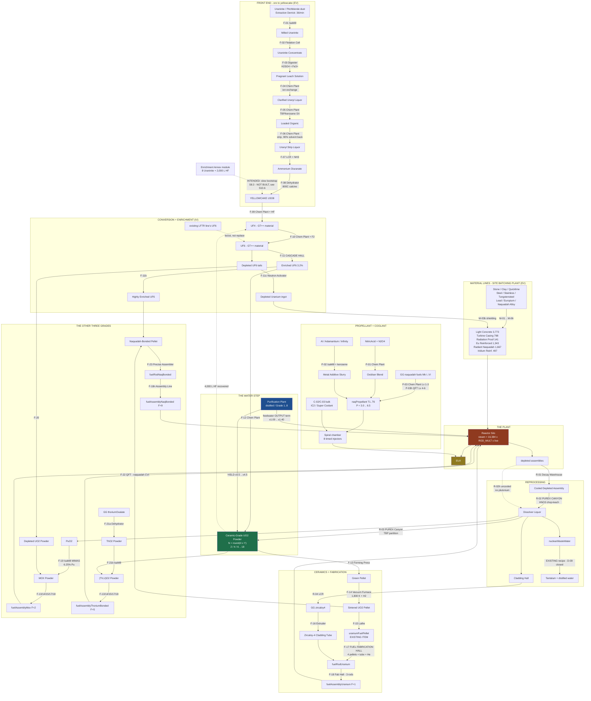

# PRODUCTION LINES — the fuel, material, propellant and coolant chains (0.24.0 design of record)

**Status: BUILT.** Sections 0-9 are the design of record - the contract the implementing units
followed. **Section 10 is the as-built record**, read back out of the shipped Java afterwards, and
where the two disagree section 10 is right. Section 11 is the flowchart the ruling asked for, and
its verification. Every GT/GT++/GG/BW class, field and recipe map named below was read out of the
pinned jar (`GT5-Unofficial-5.09.52.594-dev.jar`, D-06), not remembered.

> **Read S10.6 before shipping.** The Enrichment Annex re-point that S8.3 marks REQUIRED was **not
> made**. Until it is, `8 Uraninite + 2,000 L HF -> 20 Fuel Pellets` still skips the entire fuel
> line and does not pay the water ladder's yield term.

**My ruling, implemented here without relitigation:**

1. The purified-water grade drives **BOTH** a fuel-line YIELD term and a reactor OUTPUT term.
2. The existing 4-step chain (dust → pellet → rod → assembly) is **REPLACED ENTIRELY**.
3. The machines cover the plant's **own casings** (low tiers) **and** the propellant/coolant
   ladders (high tiers), staged by tier.
4. Implement it all, then produce a flowchart.

**Balance guard, discharged in §2.4:** the reactor OUTPUT term is the smaller of the two effects
by construction — the whole water ladder is worth **+40 % EU**, while the *smallest single rung*
of the fuel ladder is worth **+100 % EU**. Buying a water line can never substitute for the fuel
chain.

---

## 0. RECON — what actually exists today

### 0.1 `BTSRecipes.java` (486 lines, one file, 26 registration blocks)

Read in full. It registers exactly this, and nothing else:

| # | Recipe | Map | Tier |
|---|--------|-----|------|
| 1 | 1 dust Uranium + circuit 2 → **2 uraniumFuelPellet** | `assemblerRecipes` | HV |
| 2 | 4 uraniumFuelPellet + 2 plate Pt + 4 foil Pt → **fuelRodUranium** | `assemblerRecipes` | EV |
| 3 | 3 fuelRodUranium + 2 plate RhPdPalladium + 1 plate Ir + 2 ingot molten Pt → **fuelAssemblyUranium** | `assemblerRecipes` | IV |
| 4 | 4 plate StainlessSteel + 1 pipeMedium + 2 foil Pt → **2 reactorFuelColumn** | `assemblerRecipes` | EV |
| 5 | 1 dust Plutonium + 8 dust Uranium → **18 moxFuelPellet** | `mixerRecipes` | IV |
| 6 | 4 moxFuelPellet + Pt cladding → **fuelRodMox** | `assemblerRecipes` | IV |
| 7 | 3 fuelRodMox + hardware → **fuelAssemblyMox** | `assemblerRecipes` | IV |
| 8 | depletedFuelAssemblyUranium → 4 U + 2 small Pu + 1 Pb + 2 foil Pt (50 %) | `centrifugeRecipes` | EV |
| 9 | depletedFuelAssemblyMox → 3 U + 3 small Pu + 2 Pb + 2 foil Pt (50 %) | `centrifugeRecipes` | EV |
| 10 | 8,000 L nuclearWasteWater → small Tantalum + 7,200 L distilled water | `distillationTowerRecipes` | EV |
| 11 | 3 fuelRodUranium + 8 dust Thorium + 2 plate RhPdPd + molten Pt → **fuelAssemblyThoriumBonded** | `assemblerRecipes` | LuV |
| 12 | 3 fuelRodUranium + 8 dust NaquadahEnriched + 2 dust Uranium235 + 2 plate Ir + molten Naq → **fuelAssemblyNaqBonded** | `assemblerRecipes` | ZPM |
| 13 | depletedFuelAssemblyThoriumBonded → U + Th + small Pu + Pb | `centrifugeRecipes` | IV |
| 14 | depletedFuelAssemblyNaqBonded → U + Naq + small Pu + Pb | `centrifugeRecipes` | LuV |
| 15 | 1 fuelRodUranium + 3 dust Th + 1 plate RhPdPd + molten Pt → **fuelRodThoriumBonded** | `assemblerRecipes` | LuV |
| 16 | 1 fuelRodUranium + 3 dust NaqEnriched + 1 dust U235 + 1 plate Ir + molten Naq → **fuelRodNaqBonded** | `assemblerRecipes` | ZPM |
| 17–20 | depleted **ROD** reprocessing ×4 (U / MOX / Th-bonded / Naq-bonded) | `centrifugeRecipes` | EV–LuV |
| 21 | Turbine Housing | `assemblerRecipes` | IV |
| 22 | Rod Loading Port | `assemblerRecipes` | EV |
| 23 | Precision Injector | `assemblerRecipes` | IV |
| 24 | Spine Sensor | `assemblerRecipes` | EV |
| 25 | Silo Control Block / Turbine Control Block | `assemblerRecipes` | IV |
| 26 | Turbine Rotor | `assemblerRecipes` | IV |
| 27 | naqPropellant T1–T6 (6 recipes, one Mixer step each) | `mixerRecipes` | LuV–UIV |
| 28 | Extraction Platform / Enrichment Train / Reactor Core Mk1 controllers | `assemblerRecipes` | EV–IV |

Then `BTSDisplayRecipes.register()` fills the three DISPLAY-ONLY NEI pages.

**Nothing else exists.** There is no ore step, no leach, no conversion, no enrichment, no
sintering, no cladding. The "4-step chain" the ruling replaces is recipes 1–3 plus their MOX,
thorium and naquadah siblings — sixteen recipes in total (see §8).

### 0.2 `BTSItems.java` — 22 items, all of which SURVIVE

`uraniumFuelPellet`, `fuelRodUranium`, `fuelAssemblyUranium`, `depletedFuelAssemblyUranium`,
`moxFuelPellet`, `fuelRodMox`, `fuelAssemblyMox`, `depletedFuelAssemblyMox`,
`fuelAssemblyThoriumBonded`, `depletedFuelAssemblyThoriumBonded`, `fuelAssemblyNaqBonded`,
`depletedFuelAssemblyNaqBonded`, `fuelRodThoriumBonded`, `fuelRodNaqBonded`,
`depletedFuelRodUranium`, `depletedFuelRodMox`, `depletedFuelRodThoriumBonded`,
`depletedFuelRodNaqBonded`, `turbineFanMatched`, `turbineFanTDA`, `turbineFanTDAOptimized`,
`turbineRotor` (10 durability, wear on the item).

**Design constraint taken from this list:** the new chain must END at these same items. Every one
of the twenty-two keeps a route (§8). Nothing in a player's chest stops working.

### 0.3 `BTSFluids.java`

`nuclearWasteWater` + `naqPropellantT1..T6`. `nuclearWasteWater` already has a Distillation Tower
recipe to distilled water + tantalum (the D-09 profit anchor) but **no producer anywhere in the
recipe system**. The new reprocessing line (§1.6) becomes its source, which closes D-09.

### 0.4 `docs/steam-dynamics.md` — the ladders as they stand (D-08, do not change)

Propellant, stage factor P (all-8-timed):

| Rung | Fluid | P |
|---|---|---|
| — | Benzene | 1.25 |
| — | High Octane Gasoline | 1.5 |
| — | H8N4C2O4 Rocket Fuel | 2.0 |
| 1 | `BTSFluids.naqPropellantT1` | 3.0 |
| 2 | `naqPropellantT2` | 4.0 |
| 3 | `naqPropellantT3` | 5.0 (knee) |
| 4 | `naqPropellantT4` | 5.5 |
| 5 | `naqPropellantT5` | 6.0 |
| 6 | `naqPropellantT6` | 6.5 |

Coolant, quality Q: Water 1 · Distilled 1.5 · IC2 Coolant 4 · Super Coolant 12 · Liquid
Cryotheum 40 · Tachyon Rich Temporal Fluid 160.

Reactor arithmetic of record (`MTEReactorCoreMk1`):

```
ROD_MULT           = { 0, 1, 2, 5, 9 }        // empty, uranium, MOX, Th-bonded, Naq-bonded
STEAM_PER_COLUMN   = 16,384 L/t
euDemandOf(afterSpine, rpmMilli, rotorMilli, progMilli, upgradeMilli)
    = afterSpine * rpmMilli / 500_000
                 * rotorMilli               / 1000
                 * max(1000, progMilli)     / 1000
                 * max(1000, upgradeMilli)  / 1000
```

`drawFeedwater()` (line ≈4533) today accepts **Water or Distilled Water only**, drained out of
`feedwaterHatches` — the silo's own private list, never the Spiral's `chamberHatches`.

### 0.5 `questbook/gen-bom.ps1` + `BTSBom.java` — what the plant is really built from

`gen-bom.ps1` re-derives `BTSBom.java` from the structure shape code and throws if the copy on
disk disagrees; **the material lines below are sized against these numbers and no others.**

Whole-plant totals (`BTSBom.TOTAL[tier]`), the shopping list the material lines must serve:

| Piece | T1 | T2 | T3 | T4 | T5 |
|---|---|---|---|---|---|
| Light Concrete | 3,773 | 3,773 | 3,773 | 3,773 | 3,773 |
| Tungstensteel Turbine Casing | 830 | 822 | 814 | 806 | 798 |
| Radiation Proof Machine Casing | 520 | 812 | 105 | 129 | 141 |
| Europium Reinf. Radiation Proof | — | — | 963 | 1,343 | — |
| Radiant Naquadah Alloy Casing | — | — | — | — | 1,667 |
| Reactor Fuel Column *(ours)* | 360 | 616 | 872 | 1,256 | 1,608 |
| Solid Steel Machine Casing | 509 | 509 | 509 | 509 | 509 |
| Clean Stainless Machine Casing | 452 | 452 | 452 | 452 | 452 |
| Tungstensteel Reinforced Block | 362 | 442 | 249 | 249 | 249 |
| Iridium Reinforced Block | — | — | 257 | 381 | 497 |
| Steel Frame Box | 170 | 170 | 170 | 170 | 170 |
| Filter Machine Casing | 152 | 152 | 152 | 152 | 152 |
| Rod Loading Port *(ours)* | 45 | 77 | 109 | 157 | 201 |
| Steel Pipe Casing | 32 | 32 | 32 | 32 | 32 |
| Turbine Housing *(ours)* | 12 | 12 | 12 | 12 | 12 |
| Precision Injector *(ours)* | 8 | 8 | 8 | 8 | 8 |

Plus 4 Dynamo IV, 4 Energy IV, 4 Input Hatch IV, 4 Laser Source, 3 Maintenance, 3 Output Bus,
2 Input Bus, 1 Output Hatch, 1 Silo Control Block, 1 Spine Sensor, 1 Turbine Control Block.

**A T5 buildout is ≈ 8,000 blocks.** That single number is why the Site Batching Plant (§5.4)
earns its place.

### 0.6 Recipe maps an addon may register into — VERIFIED

`gregtech.api.recipe.RecipeMap` is `public final class … implements
gregtech.api.interfaces.IRecipeMap`, and `GTRecipeBuilder.addTo(IRecipeMap)` is public. Every map
below is a `public static final RecipeMap` on a class that ships inside the pinned
`GT5-Unofficial` jar, i.e. already on this addon's compile classpath (the codebase already
imports `bartworks.system.material.WerkstoffLoader` and `goodgenerator.items.GGMaterial`).

**Maps this design uses, per step:**

| Map (verified field) | Machine | Used by |
|---|---|---|
| `GTPPRecipeMaps.millingRecipes` | Ore Milling Plant (IsaMill) | F-01, F-19, F-21b, P-02 |
| `GTPPRecipeMaps.flotationCellRecipes` | Flotation Cell | F-02 |
| `LanthanidesRecipeMaps.digesterRecipes` | Digester | F-03 |
| `GTPPRecipeMaps.chemicalPlantRecipes` | Chemical Plant | F-04..F-06, F-09, F-10, F-12, F-20, P-01, P-03, C-02, C-03 |
| `GTRecipeConstants.UniversalChemical` | Chemical Reactor + LCR | F-07, F-16b, R-04, C-04 |
| `GTPPRecipeMaps.chemicalDehydratorRecipes` | Dehydrator | F-08, F-21a |
| `GTPPRecipeMaps.vacuumFurnaceRecipes` | Vacuum Furnace | F-14 |
| `RecipeMaps.centrifugeRecipes` | Industrial Centrifuge | byproduct cleanup |
| `RecipeMaps.mixerRecipes` | Mixer | F-02a, C-01 |
| `RecipeMaps.distillationTowerRecipes` | Distillation Tower | F-04b, existing waste-water recipe |
| `RecipeMaps.formingPressRecipes` | Forming Press | F-13, M-02d |
| `RecipeMaps.latheRecipes` | Lathe | F-15 |
| `RecipeMaps.extruderRecipes` | Extruder | F-16 |
| `RecipeMaps.assemblerRecipes` | Assembler | the plant's own blocks |
| `GTRecipeConstants.AssemblyLine` | Assembly Line | F-18n |
| `GoodGeneratorRecipeMaps.preciseAssemblerRecipes` | Precise Assembler | F-23 |
| `GoodGeneratorRecipeMaps.neutronActivatorRecipes` | Neutron Activator | F-11c |
| `RecipeMaps.isotopeDecay` | Decay Warehouse (`MTEDecayWarehouse`) | R-01 |
| `RecipeMaps.vacuumFreezerRecipes` | Vacuum Freezer | C-03 |
| `GTPPRecipeMaps.quantumForceTransformerRecipes` | Quantum Force Transformer | F-22, P-03h |
| `RecipeMaps.fluidSolidifierRecipes` | Fluid Solidifier | P-04 |

Useful metadata keys confirmed on `GTRecipeConstants`: `CHEMPLANT_CASING_TIER`, `COIL_HEAT`,
`HALF_LIFE`, `DECAY_TYPE`, `QFT_FOCUS_TIER`, `QFT_CATALYST`, `PRECISE_ASSEMBLER_CASING_TIER`,
`NKE_RANGE`, `RESEARCH_ITEM`, `DISSOLUTION_TANK_RATIO`, `SPARGE_MAX_BYPRODUCT`, `MASS`,
`ADDITIVE_AMOUNT`. There is **no** `RESEARCH_TIME` key — the Assembly Line research recipe carries
its own `duration()`/`eut()`; mirror an existing GT registration rather than guessing.

### 0.7 The water ladder is real and already in the pack — VERIFIED

`gregtech.api.enums.Materials` carries `Grade1PurifiedWater` … `Grade8PurifiedWater` (the
nine-unit Purification Plant chain: Clarifier, Ozonation, Flocculation, PH Neutralization,
Temperature Fluctuation, Laser Purification, Residual Degasser, Baryonic Perfection).

**The helper the implementation must use, rather than a hand-rolled comparison:**

```java
gregtech.common.tileentities.machines.multi.purification.PurifiedWaterHelpers
    public static int       getWaterTier(FluidStack);   // 0 for null/unknown, 1..8 for the grades
    public static Materials getPurifiedWaterTier(int);  // 1..8 -> the Materials constant; throws otherwise
```

Read out of the bytecode: `getWaterTier` returns **0** for `null` *and* for anything that is not
one of the eight grades — so plain water and distilled water both return 0 and must be told apart
by an explicit `isFluidEqual(GTModHandler.getDistilledWater(1))` test **before** calling it.

### 0.8 COLLISIONS FOUND — what GTNH already has, and how we sit beside it

We boost, never replace. Five real collisions were found; each is handled:

| # | What already exists | Where | Our stance |
|---|---|---|---|
| C1 | **Uraninite → Uranium metal.** `9 dust Uraninite + 4 dust Aluminium → 3 dust Uranium + 10 dust Aluminiumoxide` and `3 Uraninite + 2 Magnesium → 1 Uranium + 4 Magnesia`, both LV, both on `UniversalChemical` (`gregtech.loaders.postload.recipes.ChemicalRecipes`, bytecode offsets 3350 / 3451). | GT core | **Untouched.** That is metallothermic reduction to *metal*; our line goes to *ceramic oxide fuel*. Both consume Uraninite; neither is removed. |
| C2 | **The whole LFTR molten-salt chain.** `MaterialsFluorides.URANIUM_TETRAFLUORIDE` / `URANIUM_HEXAFLUORIDE` / `THORIUM_TETRAFLUORIDE`, `MaterialsNuclides.LiFBeF2ThF4UF4` etc., produced by `RecipeLoaderNuclearFuelProcessing` through the Reactor Processing Unit, Chemical Plant, Cold Trap, Nuclear Fuel Processing and Sparge Tower. | GT++ | **We JOIN it.** F-09/F-10 add a *second* production route to the SAME `URANIUM_TETRAFLUORIDE` / `URANIUM_HEXAFLUORIDE` materials, from ore instead of from metal. No GT++ recipe is edited or removed; a player with a standing LFTR line can feed its UF₆ straight into our cascade. The single biggest "boost, don't duplicate" decision in the document. |
| C3 | **BartWorks THTR pebble-bed fuel** — `MTEThoriumHighTempReactor`, TRISO pebbles/balls for uranium and thorium, burned-out forms. | BartWorks | **Untouched, and deliberately not imitated.** TRISO is a *pebble* fuel; ours is a *rod* fuel. Different physics, no shared item. |
| C4 | **GoodGenerator's liquid nuclear fuels** — `graphiteUraniumMixture`, `uraniumBasedLiquidFuel`, `uraniumCarbideThoriumMixture`, `plutoniumOxideUraniumMixture`, `thoriumNitrate` / `thoriumOxalate` / `thoriumHydroxide` / `thoriumTetrafluoride`, and the whole `naquadahBasedFuelMkI..MkVI` family. | GoodGenerator | **We EXTEND the thorium half.** F-21a calcines GG's existing `thoriumOxalate` into ThO₂ — a new consumer for a material that currently has one. The naquadah fuels stay the propellant line's feedstock exactly as today. |
| C5 | **`GGMaterial.zircaloy4` / `zircaloy2`** already exist with recipes. | GoodGenerator | **We CONSUME them.** F-16 extrudes GG's Zircaloy-4 into our cladding tube. Zircaloy-4 is the real PWR cladding alloy; the pack already makes it; we give it a second, large customer. |

**Checked and NOT found anywhere in the pack** (so these intermediates are genuinely new, no
collision): *yellowcake*, *uranyl*, *ammonium diuranate*, *pregnant leach solution*, *loaded
organic*, *tributyl phosphate*, *enriched/depleted UF₆*, *ceramic-grade UO₂ powder*, *green
pellet*, *sintered pellet*.

**Reagents confirmed present, so nothing below needs a new chemical chain:**
`Materials.SulfuricAcid`, `NitricAcid`, `HydrofluoricAcid`, `Fluorine`, `Ammonia`, `SodaAsh`,
`Quicklime`, `IronIIIChloride`, `PhosphoricAcid`, `Hydrogen`, `Helium`, `Thorium`,
`NaquadahEnriched`, `Uranium235`, `DinitrogenTetroxide`, `Uraninite`, `Pitchblende`;
`GTPPFluids.Kerosene`, `GTPPFluids.Butanol`, `GTPPFluids.HydrogenPeroxide`,
`GTPPFluids.BoricAcid`, `GTPPFluids.PineOil`, `GTPPFluids.IndustrialStrengthHydrofluoricAcid`;
`WerkstoffLoader.Zirconium`, `WerkstoffLoader.AmmoniumChloride`, `WerkstoffLoader.Thorianit`,
`WerkstoffLoader.CalciumChloride`.

**Confirmed ABSENT where you would expect them** (grep before you type any of these):
`Materials.Kerosene`, `Materials.HydrogenPeroxide`, `Materials.Zirconium`, `Materials.Hafnium`,
`Materials.Yellowcake`, `GTRecipeConstants.RESEARCH_TIME`.

---

## 1. THE FUEL LINE — 23 steps, ore to bundle

Real industrial process throughout the base tiers: comminution → flotation → acid leach → ion
exchange → solvent extraction → stripping → ADU precipitation → calcining → hydrofluorination →
fluorination → enrichment → reconversion → pelletising → sintering → grinding → cladding → rod
loading → bundle assembly. The UHV branch (F-22) is deliberately impossible but shaped like
chemical vapour infiltration, which is a real ceramic-composite process.

**Notation.** Items in `code` are existing registry entries; **bold** names are new BTS items or
fluids created by this design (§7 says who registers each). Tier is the recipe's `TierEU`.

### 1.1 Front end — ore to yellowcake (F-01 … F-08)

| Step | Name | Machine (map) | Tier | In | Out | Byproduct |
|---|---|---|---|---|---|---|
| **F-01** | Comminution (wet attrition milling) | Ore Milling Plant · `millingRecipes` | HV | 16 dust `Uraninite` *(or 12 dust `Pitchblende`)* + Milling Ball + 1,000 L Water | 16 **Milled Uraninite** | 2 **Gangue Dust** |
| **F-02a** | Frother preparation | Mixer · `mixerRecipes` | MV | 1,000 L `GTPPFluids.PineOil` + 2 dust `SodaAsh` + circuit 4 | 1 **Uraninite Flotation Froth Cell** | — |
| **F-02** | Froth flotation | Flotation Cell · `flotationCellRecipes` | EV | 16 **Milled Uraninite** + 1 **Froth Cell** + 8,000 L Water | 12 **Uraninite Concentrate** | 4 **Flotation Tailings** |
| **F-03** | Agitated sulfuric leach | Digester · `digesterRecipes` | EV | 12 **Uraninite Concentrate** + 6,000 L `SulfuricAcid` + 1,000 L `IronIIIChloride` *(Fe³⁺ oxidant)* | 8,000 L **Pregnant Leach Solution** | 3 **Leach Residue** |
| **F-04** | Clarification + ion exchange | Chemical Plant t2 · `chemicalPlantRecipes` | EV | 8,000 L **PLS** + 1 **Ion Exchange Resin** *(90 % returned)* | 6,000 L **Clarified Uranyl Liquor** | 2,000 L **Raffinate** |
| **F-04b** | Acid recovery | Distillation Tower · `distillationTowerRecipes` | HV | 2,000 L **Raffinate** | 1,200 L `DilutedSulfuricAcid` | 1 dust `Calcite` |
| **F-05a** | Solvent synthesis (tributyl phosphate) | Chemical Plant t2 · `chemicalPlantRecipes` | EV | 3,000 L `GTPPFluids.Butanol` + 1,000 L `PhosphoricAcid` + 4,000 L `GTPPFluids.Kerosene` | 8,000 L **TBP/Kerosene Solvent** | 1,000 L Water |
| **F-05** | Solvent extraction | Chemical Plant t3 · `chemicalPlantRecipes` | IV | 6,000 L **Clarified Uranyl Liquor** + 2,000 L **TBP/Kerosene Solvent** | 4,000 L **Loaded Organic** | 2,000 L **Raffinate** |
| **F-06** | Stripping + solvent recovery | Chemical Plant t3 · `chemicalPlantRecipes` | IV | 4,000 L **Loaded Organic** + 4 dust `SodaAsh` + 2,000 L Water | 3,000 L **Uranyl Strip Liquor** + **1,800 L TBP/Kerosene Solvent at 90 % chance — the counter-current recycle** | — |
| **F-07** | ADU precipitation | Large Chemical Reactor · `UniversalChemical` | HV | 3,000 L **Uranyl Strip Liquor** + 1,000 L `Ammonia` | 6 **Ammonium Diuranate** | 1,000 L **Ammonium Sulfate Liquor** *(a real ADU-plant co-product)* |
| **F-08** | Calcining to yellowcake (800 °C) | Dehydrator · `chemicalDehydratorRecipes` | EV | 6 **Ammonium Diuranate** | 4 **Yellowcake (U₃O₈)** | 500 L `Ammonia` recovered + 500 L `Steam` |

### 1.2 Conversion and enrichment (F-09 … F-11)

| Step | Name | Machine | Tier | In | Out | Byproduct |
|---|---|---|---|---|---|---|
| **F-09** | Hydrofluorination — "green salt" | Chemical Plant t3 | IV | 4 **Yellowcake** + 4,000 L `HydrofluoricAcid` + 1,000 L `Hydrogen` | **6 dust `MaterialsFluorides.URANIUM_TETRAFLUORIDE`** *(existing GT++ material — the C2 join point)* | 2,000 L `Steam` |
| **F-10** | Fluorination to UF₆ | Chemical Plant t3 | IV | 6 dust `URANIUM_TETRAFLUORIDE` + 2,000 L `Fluorine` | **6,000 L `URANIUM_HEXAFLUORIDE`** *(existing GT++ material)* | — |
| **F-11** | **Gas centrifuge cascade** | **Cascade Hall (NEW, §5.1)** · `btsCascadeRecipes` | IV | 6,000 L `URANIUM_HEXAFLUORIDE` + circuit 1 | 1,000 L **Enriched UF₆ (3.2 %)** + 5,000 L **Depleted UF₆ (tails)** | — |
| **F-11b** | HEU branch (for the naq grade) | Cascade Hall, circuit 2 | LuV | 1,000 L **Enriched UF₆** | 200 L **Highly Enriched UF₆** + 800 L **Depleted UF₆** | — |
| **F-11c** | DU metal (shielding) | Neutron Activator · `neutronActivatorRecipes`, `NKE_RANGE` 20–40 MeV | LuV | 5,000 L **Depleted UF₆** + 8 dust `Calcium` | 4 ingot **Depleted Uranium** | 8 dust `WerkstoffLoader.CalciumChloride` |

### 1.3 **F-12 — RECONVERSION. THE WATER STEP.** (arithmetic in §2)

Integrated Dry Route: `UF₆ + 2 H₂O + H₂ → UO₂ + 4 HF`. Chemically exact, and the *water is
literally the reagent* — which is why the ruling's water term belongs here and nowhere else.

Machine: **Chemical Plant, casing tier 3** · `chemicalPlantRecipes` · IV.

**Nine parallel recipes, one per water rung:**

```
in : 1,000 L Enriched UF6
   + 2,000 L Hydrogen
   + 2,000 L  <one of: distilled water, Grade1PurifiedWater .. Grade8PurifiedWater>
out: N x Ceramic-Grade UO2 Powder     where N = round(4 * Y(grade))   -- table in S2.1
   + 4,000 L HydrofluoricAcid  (recovered; feeds F-09 straight back)
```

Nine NEI entries side by side is exactly how GTNH already teaches this ladder (the Purification
Plant does the same), so the mechanic is discoverable without a bespoke GUI. **No new machine is
spent on the water term** — see §5.5 for why that was the right call.

### 1.4 Ceramics and fabrication (F-13 … F-18)

| Step | Name | Machine | Tier | In | Out |
|---|---|---|---|---|---|
| **F-13** | Cold pressing (green pellets) | Forming Press · `formingPressRecipes` | MV | 4 **Ceramic-Grade UO₂ Powder** + 250 L `Lubricant` *(zinc-stearate proxy)* | 4 **Green Pellet** |
| **F-14** | Sintering, H₂ atmosphere | Vacuum Furnace · `vacuumFurnaceRecipes`, `COIL_HEAT` 1,800 K | IV | 4 **Green Pellet** + 1,000 L `Hydrogen` | 4 **Sintered UO₂ Pellet** |
| **F-15** | Centreless grinding | Lathe · `latheRecipes` | MV | 1 **Sintered UO₂ Pellet** | **1 `uraniumFuelPellet`** *(THE EXISTING ITEM)* + 1 dustTiny **UO₂ Grinder Sludge** *(→ back into F-13)* |
| **F-16** | Cladding tube (pilgering) | Extruder · `extruderRecipes`, shape Pipe Tiny | EV | 2 ingot `GGMaterial.zircaloy4` | 1 **Zircaloy-4 Cladding Tube** |
| **F-16b** | End plugs + plenum spring | LCR · `UniversalChemical` | EV | 1 stick + 1 spring `StainlessSteel` + 1 plate `WerkstoffLoader.RhodiumPlatedPalladium` | 1 **Rod Hardware Set** |
| **F-17** | Rod loading, welding, He pressurisation | **Fuel Fabrication Hall (NEW, §5.2)** | IV | **4 `uraniumFuelPellet`** + 1 **Cladding Tube** + 1 **Rod Hardware Set** + 100 L `Helium` | **1 `fuelRodUranium`** |
| **F-18** | Bundle assembly (grids + tie plates) | Fuel Fabrication Hall | IV | 3 `fuelRodUranium` + 2 **Grid Spacer** + 1 plate `Iridium` + 2 ingot molten `Platinum` | **1 `fuelAssemblyUranium`** |

**Migration property, deliberate:** F-17 takes **4 pellets per rod** and F-18 **3 rods per
assembly** — the exact ratios of the retired recipes 2 and 3. Every pellet, rod and assembly
already in a player's chest keeps precisely the value it had yesterday. Only the *route* changes.

### 1.5 The other three fuel grades

**MOX (F=2) — the enrichment tails become fuel. Real (MIMAS process), and it closes the loop.**

| Step | Machine | Tier | In | Out |
|---|---|---|---|---|
| **F-20** | Chemical Plant t3 | IV | 5,000 L **Depleted UF₆** + 10,000 L `Hydrogen` + 10,000 L Water | 20 **Depleted UO₂ Powder** *(flat — no water key; §2.3)* |
| **F-19** | Ore Milling Plant · `millingRecipes` | LuV | 2 **PuO₂** + 30 **Depleted UO₂ Powder** + Milling Ball | 32 **MOX Powder** *(6.25 % Pu — the real MIMAS masterblend ratio)* |
| | then F-13 → F-14 → F-15 (circuit 2) → **32 `moxFuelPellet`** → F-17 / F-18 (circuit 2) → `fuelRodMox`, `fuelAssemblyMox` | | | |

**Thorium-bonded (F=5) — (Th,U)O₂, extending GoodGenerator's existing thorium chemistry.**

| Step | Machine | Tier | In | Out |
|---|---|---|---|---|
| **F-21a** | Dehydrator · `chemicalDehydratorRecipes` | IV | 8 **`GGMaterial.thoriumOxalate`** *(existing GG material, C4)* | 6 **ThO₂ Powder** + 2,000 L `CarbonDioxide` |
| **F-21b** | Ore Milling Plant | LuV | 30 **ThO₂ Powder** + 2 **Ceramic-Grade UO₂ Powder** + Milling Ball | 32 **(Th,U)O₂ Powder** *(6.25 % fissile driver)* |
| | then F-13 → F-14 → F-15 (circuit 3) → **Thorium-Bonded Pellet** → F-17 / F-18 (circuit 3) → `fuelRodThoriumBonded`, `fuelAssemblyThoriumBonded` | | | |

**Naquadah-bonded (F=9) — the UHV step: "unrealistic but big", shaped like chemical vapour
infiltration of a ceramic matrix.**

| Step | Machine | Tier | In | Out |
|---|---|---|---|---|
| **F-22** | Quantum Force Transformer · `quantumForceTransformerRecipes`, `QFT_FOCUS_TIER` 2 | UHV | 8 **Sintered UO₂ Pellet** + 4 dust `NaquadahEnriched` + 2 dust `Uranium235` + 200 L **Highly Enriched UF₆** + 2 ingot molten `Naquadah` + QFT catalyst | 8 **Naquadah-Bonded Pellet** |
| **F-23** | Precise Assembler · `preciseAssemblerRecipes`, casing tier 2 | UV | 4 **Naquadah-Bonded Pellet** + 1 **Cladding Tube** + 1 **Rod Hardware Set** + 100 L `Helium` | **1 `fuelRodNaqBonded`** |
| **F-18n** | Assembly Line · `GTRecipeConstants.AssemblyLine` | UV | 3 `fuelRodNaqBonded` + 2 **Grid Spacer** + 2 plate `Iridium` + molten `Naquadah` | **1 `fuelAssemblyNaqBonded`** |

### 1.6 Reprocessing — PUREX, and the D-09 closure

The four "depleted assembly → centrifuge" and four "depleted rod → centrifuge" recipes are retired
and replaced by a real head-end.

| Step | Name | Machine | Tier | In | Out |
|---|---|---|---|---|---|
| **R-01** | Spent fuel cooling pond | Decay Warehouse · `RecipeMaps.isotopeDecay`, `HALF_LIFE` / `DECAY_TYPE` metadata | EV | 1 `depletedFuelAssemblyUranium` *(and each of the other three)* | 1 **Cooled Depleted Assembly (U / MOX / Th / Naq)** |
| **R-02** | Chop-leach dissolution | **PUREX Canyon (NEW, §5.3)** | IV | 1 **Cooled Depleted Assembly** + 4,000 L `NitricAcid` | 6,000 L **Dissolver Liquor** + 2 **Cladding Hull** |
| **R-02h** | Chop-leach, **UNCOOLED** | PUREX Canyon | IV | 1 `depletedFuelAssemblyUranium` straight from the reactor + 6,000 L `NitricAcid` | 4,000 L **Dissolver Liquor** + 2 **Cladding Hull**, and **no plutonium downstream** |
| **R-03** | U/Pu co-extraction and partition | PUREX Canyon | IV | 6,000 L **Dissolver Liquor** + 2,000 L **TBP/Kerosene Solvent** | 4 **Ceramic-Grade UO₂ Powder** + 1 **PuO₂** + 1 dust `Lead` + **2,000 L `BTSFluids.nuclearWasteWater`** |
| **R-04** | Hull recovery | LCR · `UniversalChemical` | EV | 4 **Cladding Hull** + 1,000 L `HydrofluoricAcid` | 1 ingot `GGMaterial.zircaloy4` + 1 dust `WerkstoffLoader.Zirconium` |

**R-03's raffinate is `BTSFluids.nuclearWasteWater`** — the fluid whose Distillation Tower recipe
(→ distilled water + tantalum) already exists and is the D-09 profit anchor. Until now that fluid
had **no producer at all**. This closes D-09.

The **cooled vs uncooled** split is the mechanic that earns the PUREX Canyon its slot: cool your
fuel in a Decay Warehouse and you get plutonium (and therefore MOX); rush it and you get uranium
and waste only. Nothing else in the pack expresses "how long has this sat".

Rod-scale variants of R-02 / R-03 exist at one third the numbers, for the four `depletedFuelRod*`
items (the SD-1 rod cascade drops rods, not assemblies).

---

## 2. THE WATER GRADE — where it enters, and the exact arithmetic

### 2.1 The YIELD term (fuel line) — ruled ladder, applied at F-12 only

The ruling: distilled ×0.5, Grade 1 ×1.0, +0.5 per grade to Grade 8 ×4.5.

`base = 4` Ceramic-Grade UO₂ Powder per 1,000 L Enriched UF₆. Output `N = round(4 × Y)`:

| Water fed to F-12 | `getWaterTier` | Y | **N powder** | pellets | rods (÷4) | **Uraninite per rod** |
|---|---|---|---|---|---|---|
| Distilled Water | 0 *(special-cased)* | 0.5 | **2** | 2 | 0.5 | 32.0 |
| Grade 1 Purified | 1 | 1.0 | **4** | 4 | 1.0 | **16.0** |
| Grade 2 Purified | 2 | 1.5 | **6** | 6 | 1.5 | 10.7 |
| Grade 3 Purified | 3 | 2.0 | **8** | 8 | 2.0 | 8.0 |
| Grade 4 Purified | 4 | 2.5 | **10** | 10 | 2.5 | 6.4 |
| Grade 5 Purified | 5 | 3.0 | **12** | 12 | 3.0 | 5.3 |
| Grade 6 Purified | 6 | 3.5 | **14** | 14 | 3.5 | 4.6 |
| Grade 7 Purified | 7 | 4.0 | **16** | 16 | 4.0 | 4.0 |
| Grade 8 Purified | 8 | 4.5 | **18** | 18 | 4.5 | **3.6** |

Every value is an integer — `base = 4` was chosen for exactly that reason.

**The "Uraninite per rod" column is the whole balance argument.** Chain arithmetic at Grade 1:

```
16 Uraninite -F01-> 16 milled -F02-> 12 concentrate -F03-> 8,000 L PLS
             -F04->  6,000 L clarified -F05/06-> 3,000 L strip liquor
             -F07->  6 ADU -F08-> 4 yellowcake -F09-> 6 UF4 -F10-> 6,000 L UF6
             -F11->  1,000 L enriched UF6 (+ 5,000 L tails)
             -F12@G1-> 4 powder -F13/14/15-> 4 pellets -F17-> 1 fuel rod
```

The Extraction Derrick (D-17) already produces **6 Uraninite per 200 t = 36/min**. A decay cycle
is `genICampaignMinutes / 8 = 90 min` by default, so one Derrick delivers **3,240 Uraninite per
cycle**. A tier-5 silo burns **201 rods per cycle** (one per pillar).

```
3,240 / 16.0 = 202.5 rods per cycle   vs   201 rods needed
```

**At Grade 1 water, one Extraction Derrick exactly feeds a fully-built T5 plant.** Grades 2–8 buy
the headroom for the MOX / thorium / naquadah grades (which cost more input per assembly) and for
stockpiling. Distilled water halves that and does not keep up — which is the point of the ruling's
×0.5.

For comparison, the retired chain cost `2 dust Uranium ≈ 6 Uraninite` per rod. So **Grade 4
restores the old economics almost exactly (6.4), Grade 8 beats them (3.6), and Grades 1–3 are
dearer.** The water ladder is what pays for the extra fourteen steps.

### 2.2 The OUTPUT term (reactor) — the SMALLER effect

The reactor's feedwater grade multiplies EU, as one more `× n / 1000` factor on the existing
`euDemandOf` chain — the exact shape D-23's `progMilli` and D-24's `upgradeMilli` already use:

```java
euDemandOf(afterSpine, rpmMilli, rotorMilli, progMilli, upgradeMilli, waterMilli)
    = afterSpine * rpmMilli / 500_000
                 * rotorMilli               / 1000
                 * max(1000, progMilli)     / 1000
                 * max(1000, upgradeMilli)  / 1000
                 * max(1000, waterMilli)    / 1000;   // NEW
```

| Feedwater in the silo's `feedwaterHatches` | `waterMilli` | multiplier |
|---|---|---|
| `Materials.Water` | 1000 | **×1.000** (unchanged baseline) |
| Distilled Water | 1000 | **×1.000** (unchanged baseline) |
| Grade 1 Purified | 1050 | ×1.05 |
| Grade 2 Purified | 1100 | ×1.10 |
| Grade 3 Purified | 1150 | ×1.15 |
| Grade 4 Purified | 1200 | ×1.20 |
| Grade 5 Purified | 1250 | ×1.25 |
| Grade 6 Purified | 1300 | ×1.30 |
| Grade 7 Purified | 1350 | ×1.35 |
| Grade 8 Purified | 1400 | **×1.40** |

One line: **+5 % per purified grade, nothing below Grade 1.**

Plain water and distilled water stay at ×1.000 deliberately: `drawFeedwater()` accepts both today,
so a standing plant derives a **bit-identical** EU figure after this change. That is the
regression test, and it is the same test D-23 used for `progMilli == 1000`.

`drawFeedwater()` must gain the eight grades as accepted feedwater fluids, tried **worst first**
so a hatch row holding several never spends the good water when the cheap water would do.

### 2.3 Why the water key lands on exactly one step

F-12 is the only recipe in the document with a water rung. F-20 (tails → depleted UO₂ powder)
deliberately has **no** water key and a flat output, even though it is chemically the same
reaction: the water mechanic must be legible, and nine recipes on one NEI page is legible while
twenty-seven across three pages is not. In-world the justification holds too — depleted powder is
a MOX *diluent*, and MOX pellet quality is set by the PuO₂ blend, not by the wash water.

### 2.4 THE BALANCE GUARD, discharged

The ruling requires the output term to be the smaller of the two effects. It is, by two
independent measures.

**Measure 1 — span.** The water ladder moves the fuel-line yield by **×9.00** (distilled 0.5 →
Grade 8 4.5). It moves reactor output by **×1.40**. The output effect is smaller by a factor of
**6.4**.

**Measure 2 — the substitution test, which is the one that actually matters.** Can a player skip
the fuel chain by buying a water line?

```
whole water ladder, best case             : +40 %  EU   (x1.000 -> x1.400)
ONE rung of the fuel ladder, the smallest : +100 % EU   (ROD_MULT 1 -> 2, uranium -> MOX)
whole fuel ladder                         : +800 % EU   (ROD_MULT 1 -> 9, uranium -> naq-bonded)
```

**The entire water ladder is worth less than the cheapest single step of the fuel ladder, and one
twentieth of the whole fuel ladder.** A Purification Plant can therefore never be a route to
power; it is a route to *cheaper fuel*, which is a production effect, not an output effect. That
is the split, and that is why it was chosen.

### 2.5 The four-axis check for the water term

1. **CLIENT vs SERVER.** `waterMilli` is derived inside `drawFeedwater()`, which runs only on the
   server. The GUI and both control-block panels must read a **synced** field, added beside the
   existing `lastEUDemand` sync — not the raw field, which reads 0 on the client.
2. **TILE NBT vs ITEM NBT.** The grade is re-derived every tick from what is standing in the
   hatch. **Nothing is persisted**, so `saveNBTData` / `setItemNBT` gain nothing. Do not add it.
3. **PLANT-WIDE HATCH LISTS.** The grade is read from **`feedwaterHatches` only** — the silo's own
   private list. The Spiral's `chamberHatches` may legitimately hold Grade 8 water as *coolant*,
   and it must never pay the reactor's output term. This is exactly the failure mode axis 3
   exists to catch.
4. **IStructureElementChain.** The water term adds no structure. The four new machines in §5 each
   do; their `placeBlock` must never overwrite a standing tile entity, and `spawnHint` must return
   at the intended fallback.

---

## 3. THE MATERIAL LINES — the plant's own casings, staged by tier

The plant's own blocks (Reactor Fuel Column, Rod Loading Port, Turbine Housing, Precision
Injector, Spine Sensor, both Control Blocks, Turbine Rotor) keep their existing Assembler recipes
**verbatim** — they move file (§7) but not a single ingredient changes.

Everything else on the §0.5 list is a stock GT casing with a stock GT recipe. **We do not touch
those recipes.** The material lines are *bulk* routes that sit beside them, gated behind the Site
Batching Plant (§5.4), trading a multiblock and a higher voltage for 8–32× the batch.

| Step | Stage | Machine | Tier | In | Out |
|---|---|---|---|---|---|
| **M-01** | T1+ | Site Batching Plant | EV | 16 dust `Stone` + 8 dust `Clay` + 4 dust `Quicklime` + 4,000 L Water + circuit 1 | **32 Light Concrete** |
| **M-02** | T1+ | Site Batching Plant | EV | 32 plate `Steel` + 8 `frameGt` `Steel` + circuit 2 | **8 Solid Steel Machine Casing** |
| **M-02b** | T1+ | Site Batching Plant | EV | 32 plate `StainlessSteel` + 8 `frameGt` `StainlessSteel` + circuit 3 | **8 Clean Stainless Steel Machine Casing** |
| **M-02c** | T1+ | Site Batching Plant | EV | 8 Solid Steel Casing + 32 foil `Zinc` + 8 `plateDense` `Steel` + circuit 4 | **8 Filter Machine Casing** |
| **M-02d** | T1+ | Forming Press · `formingPressRecipes` | HV | 8 `frameGt` `Steel` | **8 Steel Frame Box** |
| **M-03** | T1–T2 | Site Batching Plant | IV | 8 plate `TungstenSteel` + 16 `plateDense` `Lead` + 8 `frameGt` `TungstenSteel` + circuit 5 | **8 Radiation Proof Machine Casing** |
| **M-03b** | T1–T2 | Site Batching Plant | IV | 8 plate `TungstenSteel` + 4 **ingot Depleted Uranium** *(F-11c)* + circuit 6 | **8 Tungstensteel Reinforced Block** |
| **M-04** | T3–T4 | Site Batching Plant | LuV | 8 Radiation Proof Casing + 8 dust `Europium` + 4,000 L molten `Europium` + circuit 7 | **8 Europium Reinforced Radiation Proof Casing** |
| **M-04b** | T3–T5 | Site Batching Plant | LuV | 8 plate `Iridium` + 8 `frameGt` `TungstenSteel` + circuit 8 | **8 Iridium Reinforced Block** |
| **M-05** | T5 | Site Batching Plant | ZPM | 8 plate `NaquadahAlloy` + 8 `frameGt` `NaquadahAlloy` + 4,000 L molten `Naquadah` + circuit 9 | **8 Radiant Naquadah Alloy Casing** |
| **M-06** | all | Site Batching Plant | EV | 32 plate `TungstenSteel` + 8 `frameGt` `TungstenSteel` + circuit 10 | **8 Tungstensteel Turbine Casing** |

**Real process where credible.** M-01 is an aggregate-and-cement batching plant, which is what
every real construction site of this size has on it. M-02 / M-02b / M-06 are plate-and-frame press
lines. M-03 is lead-lined shielding-panel fabrication. M-04 / M-05 are doping and cladding steps
and are frankly the "unrealistic but big" end.

**The depleted-uranium tie (M-03b) is deliberate and real:** DU is used as radiation shielding
because it is dense, and the enrichment tails from F-11 are exactly where it comes from. The fuel
line therefore feeds the casing line, which is the sort of interlock this plant should have.

**Sizing check.** A T5 plant wants 3,773 Light Concrete = **118 M-01 batches**; 1,667 Radiant
Naquadah Alloy Casing = **209 M-05 batches**; 798 Tungstensteel Turbine Casing = **100 M-06
batches**. With EV/LuV overclocks and a Processing Array those are minutes, not hours — which is
the entire justification for the line.

---

## 4. THE PROPELLANT AND COOLANT LINES

### 4.1 Propellant — real chains behind the D-08 ladder (P values unchanged)

The bottom three rungs (Benzene, High Octane Gasoline, H8N4C2O4 Rocket Fuel) are stock pack fluids
with stock chains. **Untouched.**

The six BTS rungs currently each have **one** Mixer recipe. Those six are retired and replaced by
a three-stage chain per rung — an oxidiser, a metallised fuel slurry, and a blend. That is how
real high-energy propellants are made: a fuel, an oxidiser, and a metal powder for density impulse
(aluminised propellant is the textbook case).

| Step | Name | Machine | Tier | In | Out |
|---|---|---|---|---|---|
| **P-01** | Oxidiser conditioning | Chemical Plant t2 · `chemicalPlantRecipes` | EV | 2,000 L `NitricAcid` + 1,000 L `DinitrogenTetroxide` + circuit 1 | 3,000 L **Oxidiser Blend** |
| **P-02** | Metal additive milling | Ore Milling Plant · `millingRecipes` | EV–UIV | 8 dust `Aluminium` *(Lv 1–2)* / `Adamantium` *(Lv 3–4)* / `Infinity` *(Lv 5–6)* + Milling Ball + 1,000 L `GTPPFluids.Kerosene` | 2,000 L **Metal Additive Slurry Lv n** |
| **P-03** | Blending, Lv 1–3 | Chemical Plant t3 · `chemicalPlantRecipes` | LuV–UV | 1,000 L `GGMaterial.lightNaquadahFuel` / `naquadahBasedFuelMkI` / `MkIII` + 1,000 L **Oxidiser Blend** + 500 L **Metal Additive Slurry** + circuit 5 | 250 L `naqPropellantT1` / `T2` / `T3` |
| **P-03h** | Blending, Lv 4–6 | Quantum Force Transformer · `quantumForceTransformerRecipes`, `QFT_FOCUS_TIER` 1 | UHV–UIV | 1,000 L `naquadahBasedFuelMkIV` / `MkV` / `MkVI` + 1,000 L **Oxidiser Blend** + 500 L **Metal Additive Slurry Lv 5/6** + catalyst | 250 L `naqPropellantT4` / `T5` / `T6` |
| **P-04** | Cartridge gelling *(storage and logistics only)* | Fluid Solidifier · `fluidSolidifierRecipes` | LuV | 1,000 L `naqPropellantTn` + gel mould | 1 **Propellant Cartridge Lv n** *(1,000 L; re-liquefied in a Fluid Extractor)* |

Output volume per rung is unchanged from the retired Mixer recipes (250 L per cycle), so the
Spiral chamber's supply-rate-vs-clock-frequency balance (D-20) is not disturbed. Only the input
side gets longer.

### 4.2 Coolant — bulk production only; the ladder is not touched

**Scope statement, said plainly:** the coolant ladder is a settled D-08 table of six *existing*
pack fluids. Inventing a seventh, or changing a Q, would be relitigating a ruling. This line
therefore does exactly one thing: it makes the ladder's own fluids at plant scale.

| Step | Name | Machine | Tier | In | Out |
|---|---|---|---|---|---|
| **C-01** | Deionised makeup | Mixer · `mixerRecipes` | HV | 16,000 L Distilled Water + 2 **Ion Exchange Resin** *(90 % returned)* | 16,000 L Distilled Water *(a no-op rung, present so the NEI page shows the bottom of the ladder)* |
| **C-02** | IC2 Coolant, bulk | Chemical Plant t2 · `chemicalPlantRecipes` | EV | 10× the stock GT input set + 200 L **Chemical Shim** + circuit 11 | 10× IC2 Coolant |
| **C-03** | Super Coolant, bulk | Chemical Plant t3 → Vacuum Freezer · `vacuumFreezerRecipes` | IV | 8× the stock input set + 400 L **Chemical Shim** | 8× Super Coolant |
| **C-04** | Chemical shim package | LCR · `UniversalChemical` | HV | 2,000 L `GTPPFluids.BoricAcid` + 2 dust `Lithium` + 1,000 L Water | 2,000 L **Chemical Shim** *(a real PWR boric-acid / LiOH shim; a corrosion inhibitor for C-02/C-03, never fed to the reactor)* |

Liquid Cryotheum and Tachyon Rich Temporal Fluid keep their existing pack chains untouched — both
are top-tier fluids with well-established production and neither needs a second route.

**Explicitly out of scope and flagged for a future ruling:** a *coolant recovery loop* (hot coolant
out of the Spiral chamber → chill train → cold coolant back). It would be excellent, it is
genuinely how a real plant works, and it requires changing `MTEReactorCoreMk1`'s chamber drain to
emit a fluid — which is a reactor-behaviour change, not a recipe. It is not in this document.

---

## 5. NEW MACHINES — four, each with the reason an existing one will not do

MTE ids: `Config.mteBaseId` is 28100 and `base+1` is currently unused (the register jumps from
`base` to `base+2`). New ids: **28101, 28110, 28111, 28112.**

### 5.1 Cascade Hall — MTE 28101, IV, multiblock

**Why no existing machine.** GT's Centrifuge and GT++'s Reactor Processing Unit are fixed-ratio
splitters: one input set, one output set, ratios baked into the recipe. Isotope separation is a
**cascade** — its defining property is that it produces *two* streams whose split is set by how
many stages you built, and that the tails are a real product rather than a discard. Nothing in the
pack expresses "the structure decides the split".

**Structure.** A 5×5×N hall, N = 8 + 4k for k = 0..4 (stage banks). Tungstensteel Turbine Casing
shell; each bank is a 3×3 ring of Iridium Reinforced Block around a centrifuge rotor core;
1 Maintenance, 1 Energy Hatch IV, 1 Input Hatch, 2 Output Hatch, all on **dedicated sockets**
(TC-1: no blanket wall adders — every hatch gets one cell, so the hologram shows the exact count
at the exact spot).

**Behaviour.** Stage banks set **parallel**, not assay: `parallel = 2^k`. The assay is chosen by
the recipe circuit (1 = LEU, 2 = HEU). Own recipe map `btsCascadeRecipes`, built with the same
`RecipeMapBuilder` pattern `BTSDisplayRecipes` already uses — but **real, not `.fake()`**.

⚠ Do not name this "Enrichment Train": `MTEEnrichmentTrain` (MTE 28103) already exists as the
Enrichment Annex module.

### 5.2 Fuel Fabrication Hall — MTE 28110, IV, multiblock

**Why no existing machine.** Throughput, and it is a real thing. A T5 silo eats **201 rods per
90-minute decay cycle**, in up to four grades at once. The Assembly Line is one recipe at a time
behind research; the Assembler has no parallel. A fuel fabrication plant is a continuous line and
should behave like one.

**Structure.** 7×5×12 hall: Clean Stainless Steel Machine Casing shell, a Tungstensteel Turbine
Casing spine down the centreline, 1 Maintenance, 2 Energy IV, 2 Input Bus, 1 Input Hatch, 1 Output
Bus on dedicated sockets.

**Behaviour.** `parallel = 8 × casingTier` (Clean Stainless = 1, Iridium Reinforced = 2, Radiant
Naquadah Alloy = 3), read off the structure walk. Own recipe map `btsFabricationRecipes`. Handles
F-17 and F-18 for the first three grades (circuit 1–3); the naquadah grade's *rod* goes to the
Precise Assembler and its *bundle* to the Assembly Line instead, so the top grade still costs a
real endgame machine.

### 5.3 PUREX Canyon — MTE 28111, IV, multiblock

**Why no existing machine.** The Chemical Plant and Digester can each run one dissolution recipe.
Neither can express **"the output slate depends on how long this fuel cooled"** — the mechanic that
makes reprocessing interesting and the one thing a spent-fuel head-end genuinely is. R-02 (cooled)
yields plutonium; R-02h (straight from the reactor) does not. Nothing in the pack has an input
whose *history* changes the recipe.

**Structure.** 9×7×9 shielded canyon: Radiation Proof Machine Casing shell over a Light Concrete
cell floor, 1 Maintenance, 2 Energy IV, 1 Input Bus, 2 Input Hatch, 1 Output Bus, 2 Output Hatch on
dedicated sockets. Both casings are ones the plant already needs in bulk, so the material lines
serve it too.

**Behaviour.** Own recipe map `btsPurexRecipes`. Emits `BTSFluids.nuclearWasteWater`, closing D-09.

### 5.4 Site Batching Plant — MTE 28112, EV, multiblock

**Why no existing machine.** Volume. §0.5 says a T5 buildout is ≈8,000 blocks and 3,773 of them
are Light Concrete. Hand-crafting or single-block-assembling that is the largest single friction in
building this plant, and the questbook's Blueprint quests quote those counts directly. Every real
construction site of this size has a batching plant on it; this one should too.

**Structure.** 5×5×9: Solid Steel Machine Casing shell over a Steel Frame Box lattice, one Steel
Pipe Casing riser, 1 Maintenance, 1 Energy EV, 2 Input Bus, 1 Input Hatch, 1 Output Bus on
dedicated sockets. Deliberately the cheapest of the four — it is the *first* thing a player builds,
before the silo.

**Behaviour.** `parallel = 4 × casingTier`. Own recipe map `btsBatchingRecipes`. Registers M-01 …
M-06 only; it can make nothing GT cannot already make, only faster and in bulk.

### 5.5 Candidates considered and REJECTED — and why

Discipline matters more than count. These were designed and then cut:

| Rejected | Why an existing machine does it |
|---|---|
| **Ceramic Powder Line** (a dedicated home for the water step) | Nine parallel recipes on the Chemical Plant teach the ladder just as well, and that is exactly how GTNH already teaches purified water. A bespoke GUI would be nicer and is not worth an MTE. |
| **Solvent Extraction Battery** (counter-current mixer-settler train) | The 90 %-return output chance on the organic in F-06 models the recycle loop faithfully enough on the Chemical Plant. |
| **Spent Fuel Pond** | `MTEDecayWarehouse` + `RecipeMaps.isotopeDecay` with `HALF_LIFE` / `DECAY_TYPE` metadata is *precisely* this machine, already in the pack. |
| **Pellet Sinter Kiln** | GT++'s Vacuum Furnace with `COIL_HEAT` is a sintering furnace. |
| **Propellant Blending Skid** | Chemical Plant (Lv 1–3) and QFT (Lv 4–6) already stage by tier, which is what the rung ladder needs. |
| **Coolant Conditioning Loop** | Would require changing the reactor's chamber drain to emit a fluid. That is a behaviour ruling, not a recipe. Out of scope (§4.2). |
| **Uranium Metal Reduction Furnace** | GT already reduces Uraninite to Uranium metal on `UniversalChemical` (C1). Duplicating it would break "boost, never replace" outright. |

---

## 6. TOTAL MACHINE COUNT — **25**, against a budget of 30

**Existing machines the lines require (21) — no new code for any of them:**

| # | Machine | Owning mod | Recipe map | Tier band |
|---|---|---|---|---|
| 1 | Ore Milling Plant (IsaMill) | GT++ | `millingRecipes` | HV–UIV |
| 2 | Flotation Cell | GT | `flotationCellRecipes` | EV |
| 3 | Digester | GTNH Lanthanides | `digesterRecipes` | EV |
| 4 | Chemical Plant | GT++ | `chemicalPlantRecipes` | EV–UV |
| 5 | Large Chemical Reactor | GT | `UniversalChemical` | HV–EV |
| 6 | Dehydrator | GT++ | `chemicalDehydratorRecipes` | EV–IV |
| 7 | Vacuum Furnace | GT++ | `vacuumFurnaceRecipes` | IV |
| 8 | Industrial Centrifuge | GT | `centrifugeRecipes` | MV–EV |
| 9 | Mixer | GT | `mixerRecipes` | MV–HV |
| 10 | Distillation Tower | GT | `distillationTowerRecipes` | HV–EV |
| 11 | Forming Press | GT | `formingPressRecipes` | MV–HV |
| 12 | Lathe | GT | `latheRecipes` | MV |
| 13 | Extruder | GT | `extruderRecipes` | EV |
| 14 | Assembler | GT | `assemblerRecipes` | LV–IV |
| 15 | Assembly Line | GT | `GTRecipeConstants.AssemblyLine` | UV |
| 16 | Precise Assembler | GoodGenerator | `preciseAssemblerRecipes` | UV |
| 17 | Neutron Activator | GoodGenerator | `neutronActivatorRecipes` | LuV |
| 18 | Decay Warehouse | GT | `isotopeDecay` | EV |
| 19 | Vacuum Freezer | GT | `vacuumFreezerRecipes` | IV |
| 20 | Quantum Force Transformer | GT++ | `quantumForceTransformerRecipes` | UHV–UIV |
| 21 | Fluid Solidifier | GT | `fluidSolidifierRecipes` | LuV |

**New machines (4):** Cascade Hall (IV) · Fuel Fabrication Hall (IV) · PUREX Canyon (IV) · Site
Batching Plant (EV).

**TOTAL 25.** Five under budget, and §5.5 lists the seven candidates cut to get there. Padding to
thirty would have meant building machines the pack already has, which is the one thing the "boost,
never replace" rule forbids.

Staging, as the ruling asked — casings low, propellant/coolant high:

```
EV       Site Batching Plant, Flotation Cell, Digester, Dehydrator, Extruder,
         Decay Warehouse, Distillation Tower              -> CASINGS + fuel front end
IV       Cascade Hall, Fuel Fabrication Hall, PUREX Canyon,
         Chemical Plant t3, Vacuum Furnace, Vacuum Freezer -> conversion, fabrication, coolant
LuV      Neutron Activator, Fluid Solidifier               -> propellant Lv 1-3
UV       Assembly Line, Precise Assembler                  -> naquadah grade
UHV-UIV  Quantum Force Transformer                         -> propellant Lv 4-6, naq-bonded fuel
```

---

## 7. THE FILE SPLIT — five units, zero shared files

`BTSRecipes.java` is one 486-line file and several units must add recipes at once. The split below
gives every unit files **nobody else opens**.

### 7.1 The coordinating commit (done FIRST, by one unit, before any other starts)

This is the only commit that touches the shared registrars. After it lands, **no unit edits
`BTSItems.java`, `BTSFluids.java`, `BTSMachines.java` or `BTSRecipes.java` again.**

```
BTSRecipes.java        -> emptied to an orchestrator:
                            BTSRecipesFuel.register();
                            BTSRecipesMaterials.register();
                            BTSRecipesPropellant.register();
                            BTSRecipesCoolant.register();
                            BTSRecipesMachines.register();
                            BTSDisplayRecipes.register();
BTSItems.register()    -> + BTSItemsFuel.register();
                          + BTSItemsMaterials.register();
                          + BTSItemsPropellant.register();
BTSFluids.register()   -> + BTSFluidsProcess.register();
                          + BTSFluidsPropellant.register();
BTSMachines.register() -> + 4 lines, ids base+1, base+10, base+11, base+12
BTSWaterGrade.java     -> NEW, written in full and FROZEN in this commit (see 7.3)
```

The existing 26 registration blocks move **verbatim** into their new files in this same commit, so
the split is provably behaviour-neutral before anyone adds anything.

### 7.2 Ownership

| Agent | Owns (exclusively) |
|---|---|
| **A — Fuel** | `BTSRecipesFuel.java`, `BTSItemsFuel.java`, `BTSFluidsProcess.java`, `MTECascadeHall.java`, `MTEFuelFabricationHall.java`, `MTEPurexCanyon.java` |
| **B — Materials** | `BTSRecipesMaterials.java`, `BTSItemsMaterials.java`, `MTESiteBatchingPlant.java` |
| **C — Propellant + Coolant** | `BTSRecipesPropellant.java`, `BTSRecipesCoolant.java`, `BTSItemsPropellant.java`, `BTSFluidsPropellant.java` |
| **D — Machines** | `BTSRecipesMachines.java` (the controller / hatch / control-block / rotor recipes, moved verbatim) |
| **E — Reactor** | `MTEReactorCoreMk1.java` (the water OUTPUT term §2.2 + the Annex re-point §8.3), `MTEEnrichmentTrain.java` |

Two files are *read* by more than one unit and **written by none of them after 7.1**:
`BTSWaterGrade.java` and `BTSBom.java`.

### 7.3 `BTSWaterGrade.java` — the one place the ladder is typed

```java
public final class BTSWaterGrade {
    /** 0 = distilled, 1..8 = the purified grades, -1 = not a fuel-line water. */
    public static int gradeOf(FluidStack fs);      // distilled test FIRST, then PurifiedWaterHelpers.getWaterTier
    /** Fuel-line YIELD, x1000: 500, 1000, 1500 .. 4500. */
    public static int yieldMilli(int grade);
    /** Reactor OUTPUT, x1000: 1000 for water/distilled, 1050 .. 1400 for grades 1..8. */
    public static int outputMilli(int grade);
    /** F-12 output count: round(4 * Y) = 2,4,6,8,10,12,14,16,18. */
    public static int powderFor(int grade);
    public static FluidStack fluidFor(int grade, int litres);
}
```

Agent A writes it in the coordinating commit; units A and E both consume it. The ladder is typed
**once**, so the recipe page and the reactor readout cannot drift — the same discipline
`BTSDisplayRecipes` already applies to the propellant and coolant tables.

### 7.4 Rules that keep the parallel work safe

- `git add <explicit paths>` only. Never `git add -A`.
- Commit prefix `wip:`, one commit per step group, never one at the end.
- On `index.lock`: wait two seconds and retry. Never delete it.
- No unit may add a `Materials` / `Werkstoff` / `GGMaterial` reference without grepping the pinned
  jar for it first. Several plausible names in §0.8 **do not exist** where you expect them.
- `BTSDisplayRecipes` gains a fourth page (`…plantwater`) listing the nine rungs. Its existing
  missing-dependency guard pattern applies: a rung that cannot be built must **skip, never throw** —
  `register()` runs in postInit and one escaping exception takes the whole mod down.

---

## 8. MIGRATION — every removed recipe, and what a world actually loses

### 8.1 Removed recipes — eighteen, all in `BTSRecipes.java`

| # | Removed recipe | Map | Replaced by |
|---|---|---|---|
| 1 | 1 dust Uranium → 2 `uraniumFuelPellet` | assembler | F-01 … F-15 |
| 2 | 4 `uraniumFuelPellet` + Pt cladding → `fuelRodUranium` | assembler | F-16, F-16b, **F-17** |
| 3 | 3 `fuelRodUranium` + hardware → `fuelAssemblyUranium` | assembler | **F-18** |
| 4 | 1 Pu + 8 U dust → 18 `moxFuelPellet` | mixer | F-20, **F-19**, F-13 … F-15 |
| 5 | 4 `moxFuelPellet` + Pt → `fuelRodMox` | assembler | F-17 circuit 2 |
| 6 | 3 `fuelRodMox` → `fuelAssemblyMox` | assembler | F-18 circuit 2 |
| 7 | 3 rods + 8 Th → `fuelAssemblyThoriumBonded` | assembler | **F-21a/b**, F-13 … F-15, F-18 circuit 3 |
| 8 | 3 rods + NaqEnr + U235 → `fuelAssemblyNaqBonded` | assembler | **F-22**, **F-18n** |
| 9 | 1 rod + 3 Th → `fuelRodThoriumBonded` | assembler | F-17 circuit 3 |
| 10 | 1 rod + 3 NaqEnr + U235 → `fuelRodNaqBonded` | assembler | **F-23** |
| 11 | `depletedFuelAssemblyUranium` → dusts | centrifuge | **R-01 → R-02 → R-03** |
| 12 | `depletedFuelAssemblyMox` → dusts | centrifuge | R-01 → R-02 → R-03 |
| 13 | `depletedFuelAssemblyThoriumBonded` → dusts | centrifuge | R-01 → R-02 → R-03 |
| 14 | `depletedFuelAssemblyNaqBonded` → dusts | centrifuge | R-01 → R-02 → R-03 |
| 15–18 | the four `depletedFuelRod*` → dusts | centrifuge | R-02 / R-03 rod-scale variants |

**Kept, unchanged, moved file only:** the `nuclearWasteWater` distillation (D-09), Reactor Fuel
Column, Rod Loading Port, Turbine Housing, Precision Injector, Spine Sensor, Silo Control Block,
Turbine Control Block, Turbine Rotor, Extraction Platform, Enrichment Train, Reactor Core Mk1.

**Kept but rebuilt on a longer chain:** the six `naqPropellantT1..T6` Mixer recipes become P-01 →
P-02 → P-03 / P-03h. Output volume per cycle (250 L) is identical, so D-20's supply-rate balance is
untouched.

### 8.2 Items that become unobtainable: **NONE**

This is a deliberate design constraint, not an accident. All twenty-two `BTSItems` fields keep a
route, and the two load-bearing ratios are preserved exactly:

- **4 pellets per rod** (F-17 = old recipe 2)
- **3 rods per assembly** (F-18 = old recipe 3)

So every pellet, rod and assembly standing in a chest, an ME system or a Rod Loading Port buys
exactly what it bought yesterday.

### 8.3 ⚠ REQUIRED CODE CHANGE — the Enrichment Annex is now a bypass

> **STATUS: NOT DONE.** Verified in the shipped source - both call sites below still pay
> `uraniumFuelPellet`. See S10.6 for what that costs and what is left to do. The rest of this
> section is the unchanged specification of the fix.

`MTEReactorCoreMk1.annexPellets()` and `MTEEnrichmentTrain.checkProcessing()` currently output
**`BTSItems.uraniumFuelPellet`** directly:

```
MTEEnrichmentTrain.java:145   new ItemStack(BTSItems.uraniumFuelPellet, OUTPUT_PELLETS)
MTEReactorCoreMk1.java:5910   out.add(new ItemStack(BTSItems.uraniumFuelPellet, annexPellets()));
```

`8 Uraninite + 2,000 L HF → 20 Fuel Pellets` every 600 t. **Left alone, that skips the entire fuel
line.** It must be re-pointed to yellowcake:

```
8 Uraninite + 2,000 L HydrofluoricAcid  ->  2 Yellowcake (U3O8)     every 600 t, 480 EU/t
```

The ratio is chosen to match the main line exactly (F-01 … F-08 turn 16 Uraninite into
4 Yellowcake — 4 Uraninite per Yellowcake, identical), so the Annex stays a **slow, HF-hungry
bootstrap** past the front end while F-09 … F-18 remain compulsory. That is precisely the module's
designed role ("the campus processing factory"), and it stops being a shortcut past the interesting
steps.

Everything that quotes the Annex must move with it: `MTEEnrichmentTrain` tooltip (line 159),
`MTEReactorCoreMk1` tooltip (line 8150), the D-17 row in `../PROPOSAL.md`, the wiki, and the
questbook — rebuilt via `powershell -NoProfile -ExecutionPolicy Bypass -File questbook/gen-bom.ps1`,
the one command that re-renders `BTSBom.java` **and** `questbook/DefaultQuests` together. Never run
one without the other.

Owner: **Agent E.** Four-axis note: `annexPellets()` is read by a GUI panel, so its replacement must
stay on the existing sync path (axis 1), and the Annex's sockets join **no plant-wide hatch list**
(axis 3) — that property must survive the edit.

### 8.4 What an existing world loses, plainly

**Dead automation.** Every standing Assembler, Mixer and Centrifuge running one of the eighteen
retired recipes stops on world load. No crash, no item loss, no machine damage — GT simply finds no
recipe and the machine idles. **Eighteen AE2 / pattern / Steve's-Factory setups go invalid** and
must be rebuilt against the new chain. This is the cost I accepted when ruling that the old
chain is replaced entirely.

**A depleted-fuel backlog window.** Reprocessing now needs the PUREX Canyon, an IV multiblock.
Between world load and that building standing, depleted assemblies and rods pile up with nowhere to
go. **Mitigation, built into the design:** R-02h accepts *uncooled* assemblies straight from the
reactor, so the PUREX Canyon **alone** clears the backlog — a Decay Warehouse is only needed for the
plutonium, and therefore only for MOX. One machine unblocks; two machines pay.

**The Annex changes what it makes.** Any output bus, AE2 storage bus or logistics pipe reading the
Enrichment Annex's socket now receives **Yellowcake, not Fuel Pellets**. Flag it in the changelog,
in the module tooltip and in the questbook step that quotes it.

**A steeper front end at low water grades.** At Grade 1 the chain costs 16 Uraninite per rod against
the retired chain's ~6, and it takes an IsaMill, a Flotation Cell, a Digester, a Chemical Plant and
a Dehydrator to reach yellowcake. **Grade 4 water restores the old cost almost exactly (6.4) and
Grade 8 beats it (3.6)** — the Purification Plant is how a player buys the old economics back, which
is the whole point of the ruling.

**Nothing is lost that a player is holding.** No item is deleted, no NBT is rewritten, no structure
changes shape, and no standing plant un-forms. A plant that never feeds purified water derives a
bit-identical EU figure to the one it derived before this release (§2.2).

### 8.5 Release checklist

1. Coordinating commit (§7.1) — split only, zero behaviour change, `spotlessApply compileJava` green.
2. Agents A–E in parallel, `wip:` commits per step group.
3. `powershell -NoProfile -ExecutionPolicy Bypass -File questbook/gen-bom.ps1` — the ONE command
   that re-renders `BTSBom.java` and the questbook together.
4. `./gradlew.bat spotlessApply compileJava --no-daemon` to BUILD SUCCESSFUL.
5. The flowchart — **built**, `docs/production-flowchart.html`, verified in-browser (§11).
6. Changelog: the eighteen dead recipes, the water ladder, and **the Annex re-point once it lands** (§10.6).
7. A browser mockup for each of the four new multiblocks (standing rule, D-19).

---

## 9. THE FLOWCHART



**Reading the chart.** The two blue-to-green edges out of `Purification Plant` are the ruling: the
one into `Ceramic-Grade UO2 Powder` is the **YIELD** term (×0.5 … ×4.5), the one into `Reactor Silo`
is the **OUTPUT** term (×1.00 … ×1.40). The dashed edges are the boosts that keep existing content
alive — the LFTR line's UF₆ feeding our cascade, the Annex bootstrapping past the front end, and the
uncooled reprocessing path that unblocks a legacy world's depleted-fuel backlog.

---

## 10. AS-BUILT — what actually shipped, and where it differs from §§1–9

**Everything above this line is the design of record; everything below it was read back out of the
Java after the fact.** Where the two disagree, this section is right and the design section is the
history of how we got there. Every figure here was produced by grepping
`BTSRecipesFuel/Materials/Propellant/Coolant.java`, `BTSWaterGrade.java` and
`MTEReactorCoreMk1.java`, not by trusting an implementation report.

### 10.1 The count, derived

| File | Owner | `stdBuilder()` sites | Recipes actually registered |
|---|---|---|---|
| `BTSRecipesFuel.java` | A — Fuel | 46 | **85** (84 new + 1 kept) |
| `BTSRecipesMaterials.java` | B — Materials | 12 | **12** |
| `BTSRecipesPropellant.java` | C — Propellant | 14 | **32** |
| `BTSRecipesCoolant.java` | C — Coolant | 3 | **3** |
| `BTSRecipesMachines.java` | D — Machines | 11 | **11** (moved verbatim) |
| | | | **143 total, 132 in the four production lines** |

Sites ≠ recipes because eight helpers and one loop multiply: `pressGreenPellet`/`sinter`/`grind`/
`loadRod`/`bundle` are called **three** times each (uranium, MOX, thorium), `coolInPond`/
`chopLeach`/`rushLeach` **eight** times each (four grades × rod and assembly), and `reconversion()`
loops the **nine** water rungs. That is the arithmetic behind the "132 registered recipes" the
flowchart prints — and the flowchart computes it from its own step table rather than quoting it, so
the two cannot drift.

**Machines: 4 new, 21 existing = 25**, exactly as §6 budgeted, against a budget of 30. MTE ids
28101 (Cascade Hall), 28110 (Fuel Fabrication Hall), 28111 (PUREX Canyon), 28112 (Site Batching
Plant), all confirmed in the class javadoc of each.

### 10.2 The water ladder, as coded

`BTSWaterGrade.java` is the single source and is frozen. Verified by reading it:

```java
yieldMilli(0) = 500;  yieldMilli(g) = 1000 + (g - 1) * 500;   // distilled x0.5 .. Grade 8 x4.5
outputMilli(g) = (g < 1) ? 1000 : 1000 + g * 50;              // x1.000 .. x1.400
powderFor(g)   = 4 * yieldMilli(g) / 1000;                    // 2,4,6,8,10,12,14,16,18
```

The reactor's sixth factor is present at `MTEReactorCoreMk1.euDemandOf(...)` as
`* Math.max(1000, waterMilli) / 1000`, and `feedwaterGrade` is a synced field set only inside
`drawFeedwater()`. **The `Math.max(1000, ...)` floor is what makes the release regression-safe:**
plain and distilled water both grade to 1000, so a standing plant multiplies by exactly 1 and
derives a bit-identical EU figure to 0.23.0.

F-12 asks `BTSWaterGrade.powderFor(grade)` for its output count rather than typing it, and skips
any rung whose fluid the pack does not have (`fluidFor` returns null) instead of throwing —
recipe registration runs in postInit, where one escaping exception costs the whole mod.

### 10.3 Forced deviations from §§1–4 — twelve, each with the reason

The design established *which* recipe maps an addon may register into, but not their **shape**.
`maxIO` was read out of each map's static initialiser during implementation, and five of the
tables in §1 could not be expressed as drawn.

| # | Design said | Built as | Why |
|---|---|---|---|
| 1 | F-01 mills with wash water, drops gangue | no fluids, one output | `millingRecipes` is `maxIO(3,1,0,0)` — **zero fluid slots**. Milling balls come from the mill's own hatch, so a ball in `itemInputs` would have made every recipe eat one |
| 2 | F-02 Flotation Cell → concentrate (solid) | → **froth FLUID**, new F-02b dewaters it | `flotationCellRecipes` is `maxIO(6,0,1,1)` — **zero item outputs**. GT++'s own sphalerite line has the same shape. This is why `uraniniteFlotationFroth` exists |
| 3 | F-03 leaches with an Fe(III) oxidant | **dust Pyrolusite** | The Digester allows one fluid in. Pyrolusite is the solid oxidant a real acid-leach flowsheet charges anyway — the constraint improved the chemistry |
| 4 | F-11c byproduct is calcium **chloride** | calcium **fluoride** (dust Fluorite) | There is no chlorine anywhere in this chain. Reducing a *fluoride* with calcium gives a fluoride, and 8 Ca in balances 8 fluorite out |
| 5 | F-15 selects grade by circuit | grade-**tagged** sintered pellets | `latheRecipes` is `maxIO(1,2,0,0)` — one input, so **no circuit slot**. Hence `sinteredPelletMox` / `sinteredPelletThorium` |
| 6 | F-13/F-14 select grade by circuit | circuit **plus** tagged items | A circuit cannot survive an item. One fungible green pellet would let uranium powder be pressed, sintered and ground on circuit 2 into MOX pellets **with no plutonium in the line** |
| 7 | F-16 extrudes the cladding tube | **Assembler**, behind circuit 7 | `extruderRecipes` is `maxIO(2,1,0,0)` and a die spends both slots, so the recipe would be indistinguishable from GT's own `ingot + die` and one of the two would silently become unreachable |
| 8 | P-02 mills metal in kerosene, one step | split **P-02a / P-02b** | Same zero-fluid-slot problem as F-01 |
| 9 | P-01 uses `Materials.DinitrogenTetroxide` | `getGas`, and **both** N₂O₄ fluids | GT's N₂O₄ is gas-side, and the pack has two of them (GT core's and `GTPPFluids`') — registering both means a standing rocket-fuel line is not forced to build a second one |
| 10 | C-04 on `UniversalChemical` | straight to the **LCR** | `UniversalChemical` fans out to the single-block reactor, which is `maxIO(2,2,1,1)` — one fluid input, and C-04 has two |
| 11 | M-02d presses filter casings | folded into M-02c | Pressing implies a blank, which implies a new item; `BTSItemsMaterials` registers nothing by decision. Everything in the materials file goes to **one** map |
| 12 | M-05 makes 8 casings a batch | 20 (M-05a) / 32 (M-05b) | 8× would want 96 plates in one slot and **a stack stops at 64**. The same limit forced M-04 off fasteners (8 casings = 192 screws) and onto diffusion bonding |

### 10.4 Three judgement calls the implementers made, recorded here

1. **The propellant ladder was NOT retired.** §4.1 and §8.1 said the six one-step Mixer recipes
   were "kept but rebuilt" — i.e. replaced. They are **kept standing, unchanged**, and the
   three-stage chain was added beside them. My ruling that fuel-chain automation may break
   covers the *fuel* chain; no ruling covers the propellant ladder, and retiring the only recipe
   that makes the fluid a running plant drinks would stop that plant dead on jar swap. The design's
   P-03 as written was strictly dominated anyway (same naquadah fuel **plus** oxidiser and slurry),
   so nobody would ever have built it.
2. **C-01 was deliberately not shipped.** As specified it consumed ion-exchange resin and returned
   its own input — a no-op that bills the player for nothing and a loop an autocrafter can chase.
   Its stated purpose (showing the ladder's bottom in NEI) is already served by
   `BTSDisplayRecipes.plantCoolant`.
3. **Three ultrafine metal powders were added** to `BTSItemsPropellant`, which §7.2 had scoped to
   cartridges only. One fungible powder would have let cheap aluminium be blended into an
   Infinity-grade slurry — the same "a circuit cannot survive an item" rule that F-13/F-14 rest on.

### 10.5 Two defects the implementers caught, and what they cost

- **F-07's ammonium sulfate liquor was a stall, not untidiness.** It had a producer and no
  consumer, and **a GT machine with a full output hatch stops.** The first player to automate F-07
  without a void hatch would have watched the reactor's fuel supply halt on a byproduct. F-07b now
  cracks it, returning 300 of the 1,000 L of ammonia. Every one of the fuel line's 21 fluid streams
  and 30 item intermediates was then re-walked for the same defect.
- **`OrePrefixes.screw.mMaterialAmount` is M/8, not M/9.** M-04's europium was computed on the
  wrong assumption and would have shipped **7 % cheaper in europium** than the stock recipe it sits
  beside — silently, in the one line item where 1,343 casings makes 7 % matter. The amounts are now
  read off the decompiled `OrePrefixBuilder` calls rather than from memory.

### 10.6 ⚠ OUTSTANDING — §8.3 did NOT happen. The Annex bypass is still live.

**This is the one part of the design that is not built, and it is load-bearing.** Verified in the
shipped source on the date of this section:

```
machines/MTEEnrichmentTrain.java:145   new ItemStack(BTSItems.uraniumFuelPellet, OUTPUT_PELLETS)   // 20
machines/MTEReactorCoreMk1.java:6009   out.add(new ItemStack(BTSItems.uraniumFuelPellet, annexPellets()));
```

Both still pay **`uraniumFuelPellet` directly** from `8 Uraninite + 2,000 L HF` every 600 ticks.
`ANNEX_PELLETS = 20` at `MTEReactorCoreMk1.java:5744` is unchanged.

**Consequence, stated plainly:** a player who builds the Enrichment Annex — which is a module of the
main controller, not a separate multiblock, and is already taught by the questbook — gets fuel
pellets at **0.4 Uraninite per pellet** without touching F-01 … F-16. The entire twenty-three-step
fuel line, the Cascade Hall, the Fuel Fabrication Hall and the whole water ladder become optional
decoration for uranium-grade fuel. The yield term is the ruling's *primary* effect, and this route
does not pay it.

**The fix is still the one §8.3 specifies** — re-point both call sites to `2 Yellowcake`, which is
the same 4 Uraninite : 1 Yellowcake ratio F-01 … F-08 achieve, so the Annex stays a slow HF-hungry
bootstrap past the *front end* while F-09 … F-18 remain compulsory. It is a two-line change plus
the tooltips at `MTEEnrichmentTrain:159` and `MTEReactorCoreMk1:8150`.

**Until it lands, the documentation must not claim it did.** The wiki, the questbook and the D-26
row in `../PROPOSAL.md` all describe the Annex as it currently behaves, and each carries the same
warning. That is deliberate: a book that describes the intended design rather than the shipped code
is how a player ends up building something that does not work.

### 10.7 What still cannot be settled statically

None of the four new multiblocks has been **formed in world**. Their recipe shapes are proven
against the map limits and their structure definitions compile, but the Cascade Hall's negative
depth offsets, the Fabrication Hall's 7×5×12 and the Canyon's 9×7×9 want a `/btsbuild` projection
test before 0.24.0 ships (standing rule, D-19). Two further first-load questions are worth watching:
whether the circuit numbers actually disambiguate M-03a/M-03b/M-03c in a bus holding several
programmed circuits, and whether one Input Hatch comfortably holds M-05b's 13,824 L × parallel.

---

## 11. THE FLOWCHART, BUILT

**`docs/production-flowchart.html`** — a self-contained page: no external requests, full light and
dark theming through CSS tokens (never defined only inside a media query), and a theme toggle that
remembers its setting. It carries the master diagram as **plain SVG** — deliberately not canvas,
which cannot be screenshotted reliably outside a `requestAnimationFrame` turn — plus every one of
the 67 steps as a card with its machine, tier band and real inputs and outputs.

**It was verified in a real browser, not eyeballed**: served over `127.0.0.1:8731`, opened in
Chromium, and audited in the DOM.

- **0 console messages** of any level, errors and warnings alike.
- **0 edge segments passing through a node box**, checked by walking every `path.e` and testing
  each straight segment against every `rect.nbox`.
- **0 text runs overflowing their box or the viewBox.**
- **0 horizontal page overflow** at 1440 px.

That audit found four real defects that reading the file had not: the Fabrication Hall's sub-line
ran past its own box, the material edge cut straight through the "Unit One" lane label, `.nid`'s
`text-transform: uppercase` had turned `MTEReactorCoreMk1` into an unreadable
`MTEREACTORCOREMK1`, and the "new multiblocks" figure counted machine **labels** rather than
machine **identities** — reporting six where there are four, because the PUREX Canyon appears as
"circuit 1", "circuit 2" and "circuit 3".

The mermaid graph in §9 is kept as the design-time sketch. **Where it disagrees with the HTML, the
HTML is as-built** — §9 still draws F-16 on the Extruder and F-02 producing a solid, both of which
§10.3 shows could not be registered that way.
